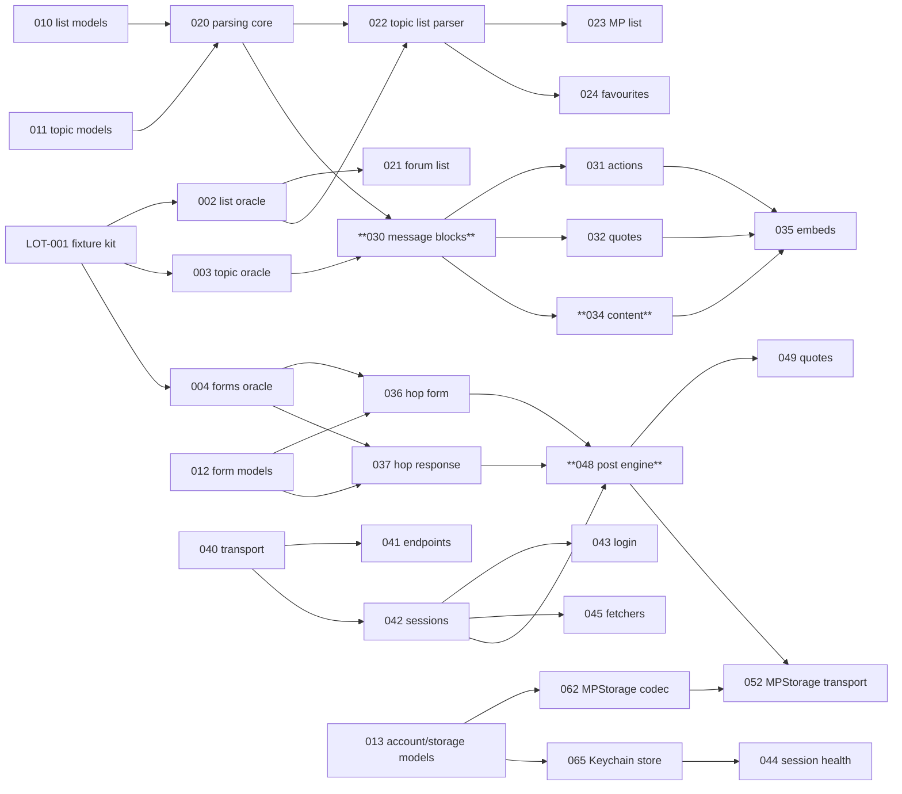

# Phase 1 — Legacy engine audit (LOT-000)

Audit of the legacy app's engine to plan its migration into `HFRKit`.
Legacy reference: <https://github.com/francoisgn/hfrnow> at commit `2440d79`. Audit by five parallel agents (Sonnet), synthesis by Opus, review of the split by Fable.

| Report | Area |
|---|---|
| [A — Network & sessions](A-network-sessions.md) | Loader workers, login, accounts, cookies, search services, ASIHTTPRequest |
| [B — List parsing & models](B-list-parsing-models.md) | Forum/topic/MP/favourites parsers, data models, polls |
| [C — Message parsing](C-message-parsing.md) | Topic page parsing, content rewriting, WKWebView rendering |
| [D — Posting](D-posting.md) | Reply, quote, edit, delete, new topic, MP, alerts, AQ, flags, MPStorage, smileys, rehost |
| [E — Storage & vendors](E-storage-vendors.md) | UserDefaults, files, Keychain, data migration, vendor inventory |

Every fact in the reports cites `file:line` in the legacy repo. **No real HFR page exists in the legacy repo**: every statement about the HTML structure is read from code and marked *unverified* until Phase 2 captures fixtures.

## Results

- [docs/LOTS.md](../LOTS.md): 51 lots after LOT-000 (4 Phase 2 tooling, 46 engine, 1 gate), merged from ~66 overlapping proposals, with dependencies, difficulty and model routing. 14 lots (✱) need no fixtures and can start right away.
- [docs/HFR-PROTOCOL.md](../HFR-PROTOCOL.md): consolidated protocol reference (endpoints, write flows, cookies, tokens, encoding).
- [ADR 0006](../adr/0006-content-normalization-in-parsing.md) (proposed) and [ADR 0007](../adr/0007-third-party-api-keys.md) (proposed).

## Key findings

### What the legacy engine really is
- **Live code is smaller than it looks.** The 3,371-line `MessagesTableViewController.m` is not compiled into HFRswift; its logic was copied into the ObjC workers and renderer classes (C §1). Only `Catcounter` among the models is legacy-only (B §1).
- **The Swift app reaches ObjC through reflection** (`NSClassFromString` + `unsafeBitCast`), with no compile-time checking (A §2, B §1).
- **Parsers have side effects**: they write `hash_check`, the MP badge and `UserDefaults`, and apply blacklist/whitelist policy and avatar downloads while parsing (B §3, C §3). The new parsers are pure; policy moves app-side (Phase 4 backlog).
- **One shape for almost every write**: GET a page with `<form name="hop">`, copy its fields, override a few, POST to its action, classify the `.hop` response (D §2). One engine (LOT-048) covers reply, edit, delete, new topic and MP.
- **Bookmarks, synced blacklist and MP flags live in a private message** used as a JSON database, read-modify-written without conflict protection (D §2.10, E §2).

### Fragility to fix by design
- Positional DOM access and exact/substring class matching crash on unexpected markup (B §4).
- HTML rewriting by regex over libxml2's serialized output (C §4) → DOM-level rewriting with SwiftSoup (ADR 0006).
- No HTTP status check in workers; a maintenance page or login wall becomes an empty list (A §3.4, B §4) → typed errors.
- Global session state: one shared cookie jar wiped and refilled on every account switch, one global `hash_check` (A §4) → per-account isolated sessions (LOT-042).

### Visible bugs (not to reproduce; each becomes a documented intentional difference)
YouTube start-time hour offset (C) · multi-quote cookie matches post ids by substring (C) · private topics treated as public in filtered mode (C) · attribute values not entity-decoded in forms (D) · emoji no longer stripped before posting (D) · accented characters not percent-encoded in global search (A) · login clears cookies before validating credentials (A) · smiley search decodes Latin-1 first (A) · `BlackList` can overwrite its file with an empty list (E) · "last access" never persisted (E) · ~1,000 duplicated lines in `ReplyService.swift` (D).

### Security findings in the legacy app
- **Hard-coded API keys** (Giphy, image rehost) in the Swift sources. Values deliberately not copied here. Recommendation: rotate them; the new app injects keys from configuration (ADR 0007).
- `adv_ssl` setting disables TLS certificate validation for all ASIHTTPRequest traffic (A §6) — not carried over.
- Accounts serialized with `NSKeyedArchiver` (non-secure coding) in the Keychain (A §4.3, E §2). Passwords are never stored (good).
- AQ sends the user's pseudo and post data to a third-party service with no authentication (D §2.7) — product decision (Q-4).

### Vendors
HFRswift still links ASIHTTPRequest, HTMLParser, RegexKitLite, Reachability, SimpleKeychain and the Giphy SDK (+ libiconv, libicucore). Each maps to the lot that removes it in E §6; none is carried over except SwiftSoup (already approved).

## Dependency graph (critical path in bold)

## Recommended start (parallel tracks)

1. **Phase 2 now** — LOT-001 on the maintainer's Mac: fixtures unblock every parser and the write engine.
2. **Fixtures-free lots in parallel** — models (010–014), parsing core (020), transport/endpoints/sessions (040–042), storage (060–063, 066).
3. **Then the critical path** — 003 → 030 → 034 (Fable), and 004 → 036/037 → 048 (Opus).

## Decisions needed

| Id | Question | Blocks | Proposed answer |
|---|---|---|---|
| ADR 0006 | Where does DOM-level content rewriting live, given SwiftSoup is confined to `HFRParsing`? | LOT-034 | In `HFRParsing`, driven by `MessageRenderOptions` (see ADR) |
| ADR 0007 | How are third-party API keys injected; keep Giphy? | LOT-056, Giphy | Build configuration + CI secret, never committed; Giphy decision deferred to Phase 4 |
| Q-1 | Does SwiftHFR reuse the legacy bundle id (`hfrplus.red.super`) and team, enabling an in-place update and data import? | LOT-067 | Maintainer decision |
| Q-2 | Server charset per endpoint (UTF-8 vs ISO-8859-1) | LOT-040 decoding defaults | Settle with Phase 2 fixtures (raw bytes + headers) |
| Q-3 | Emoji policy when posting (strip like legacy, keep, or encode) | LOT-048 | Test on a real post in Phase 2, then decide |
| Q-4 | Keep the AQ third-party integration (pseudo sent unauthenticated)? | LOT-055 | Maintainer decision |
| Q-5 | Offline reading in scope? | LOT-066 scope | Out of scope unless requested |
| Q-6 | MPStorage merge semantics across clients (other HFR+ clients write the same document) | LOT-062, LOT-052 | Conflict-aware merge, wire-compatible; confirm with other clients' authors if reachable |

Each report also lists area-specific open questions (A §9, B §7, C §9, D §10, E §9).
