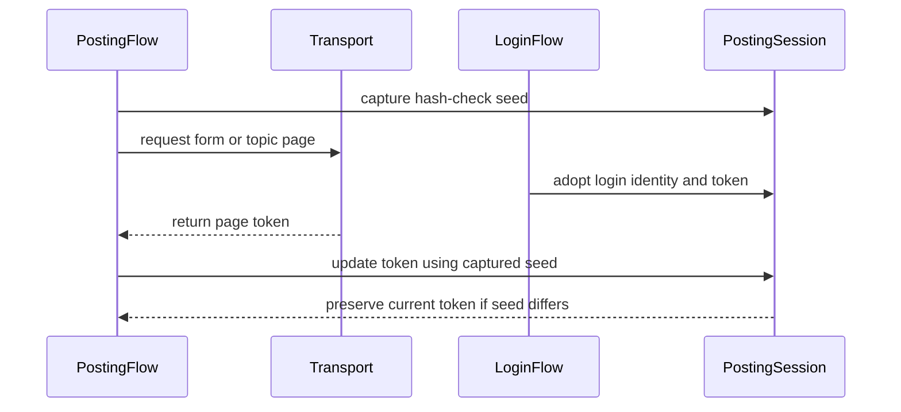

# PR #315: #308: keep the fresher hash_check after a concurrent login (PostingFlow, TopicFlagFlow)

- State: closed (merged)
- Author: francoisgn · created 2026-10-28T14:47:34Z · updated 2026-11-11T21:15:12Z
- Labels: —
- Source: https://github.com/ezzz/HFRnow/pull/315
- Branch: ezzz:fix/308-fresher-hash-check → dev-swift · head a62ed03e40d5790fe94ae9b280f42b8fff57bb68
- Merged as 7c8723f1bf78261e8e895b7345a2302d82484a7f on 2026-10-30T06:37:36Z

Closes #308
Claim: ext/opus-helper1
Author model: Claude Opus 5.5

Not a lot (bug found by the Fable review of LOT-051, PR #263).

## Problem
`PostingFlow.loadForm` (`PostingFlow.swift:130`) and `TopicFlagFlow.markRead` (`TopicFlagFlow.swift:98`) wrote the page's `hash_check` into the session unconditionally after their GET. If LOT-043's `adoptLogin` installed a new login (new cookies + token read with them) while that GET was in flight, the flow overwrote the fresher token with the one belonging to the old cookies; the next POST then gets HFR's bad-token answer (`W17b`).

## Cause
The write-back was a blind set, not a compare-and-set against the session's state when the request left. LOT-044's `adoptRefresh` already follows the CAS rule; these two flows did not.

## Change
- `HashCheckSeed` (HFRClient, `Posting/HashCheckSeed.swift`): identity (`userKey`) + token, read in one actor turn before the request. `PostingSession.updateHashCheck(_:since:now:)` records the page token only if the session still holds that exact seed, in one actor turn (extension of an `Actor`-constrained protocol → isolated, atomic).
- Both flows take the seed before the GET and use the CAS write. The read mark / form load result itself is unchanged; only the token write is skipped.
- Why identity **and** token, not identity alone as the issue suggested: a re-login of the **same** account keeps `userKey` but changes the token (identity-only would miss it); a logout (`removeAllCookies`) keeps the token but drops the identity (token-only would miss it). Both checks cost nothing.
- Decision recorded in the LOT-043 spec (edge cases): CAS chosen over an app-level "one flow at a time per session" rule, which nothing in the engine would enforce. LOT-048/LOT-051 specs updated to say the token is recorded unless a login was adopted meanwhile.
- `FlagSession` folded into `PostingSession`: its only requirement (`hashCheck`) is now needed by both flows. `PostingSession` also requires `userKey(now:)` (both satisfied by `HFRSession` as is). Internal protocols only, no public API change.
- `TopicFlagError` doc: "nothing changed" → "a refusal by LOT-037's shape rule (no `addflag` or `delflag` refusal is captured)".
- LESSONS row 54 appended.

Out of scope (noted, not done): a `PostingForm` loaded before an account **switch** in the same session still carries the old account's `hash_check`/`pseudo` in its fields; submitting it would be refused by HFR (bad token). The app uses one `HFRSession` per account (`AccountsModel`), so this needs a re-login with other credentials into the same session, which `expectedUserKey` already refuses. Tell me if you want an explicit `sessionChanged` error there.

## Tests
`Tests/HFRClientTests/Session/ConcurrentLoginTokenTests.swift` (Swift Testing):
- `markReadKeepsFresherToken` (R21) and `loadFormKeepsFresherToken` (R40a), each with a same-account re-login and an account switch adopted while the GET is suspended in the scripted session: the fresher token stays, no `updateHashCheck` call is made, the read mark is still returned.
- `loadFormRecordsToken` (R40a): control, no concurrent login → the page token is recorded.
- `compareAndSetOnHFRSession` / `changeAfterSeedWins` on a **real** `HFRSession` (no network): re-login, account switch (`adoptLogin`) and logout after the seed all keep the session's state.

Shown to fail without the change: with the CAS guard replaced by an unconditional write, 5 of the new tests fail (14 issues; the logout case fails too, proving the identity check matters). Scripted sessions now model `hashCheck` and `userKey` like `HFRSession`.

`swift build && swift test`: 964 tests / 111 suites green on Linux. `python3 scripts/check-lot-deps.py`: 0 violations. SwiftLint not runnable in this session: checked by hand per LESSONS 21 (line length ≤ 140, no `String(decoding:)`), CI is the arbiter.

## LEGACY FIXES
None: legacy used one global jar and no concurrent login (no CHANGELOG-LEGACY row).

## PENDING CAPTURE
None needed: the race is engine-side; tests use R21, R40a and fake tokens.

---
_Generated by [Claude Code](https://claude.ai/code/session_014QH2CHAtE1bjFGqCXryLBy)_

<!-- This is an auto-generated comment: release notes by coderabbit.ai -->
<!-- coderabbit-ai-generated:v1 -->

## Summary by CodeRabbit

* **Bug Fixes**
  * Prevented page responses from replacing a newer session token when a login, account switch, or logout occurs while a request is in progress.
  * Preserved token updates from read-mark and form-loading requests when the session identity and token remain unchanged during the request.

* **Documentation**
  * Clarified how refusals and login changes during in-flight requests affect flag and token handling.
  * Noted that a refusal does not confirm that nothing changed, and that unconfirmed actions reload state rather than resend automatically.
<!-- end of auto-generated comment: release notes by coderabbit.ai -->

## coderabbitai[bot] · 2026-10-28T14:47:43Z

<!-- coderabbit-ai-generated:v1 -->

<!-- This is an auto-generated comment: summarize by coderabbit.ai -->
<!-- review_stack_entry_start -->

<a href="https://app.coderabbit.ai/change-stack/ezzz/HFRnow/pull/315?scope=ghh_OusAJGA4HG8ljoOV0wJvVx8NmnZIjc2DdjmxOu0xZWA&amp;cs_source=review_comment"><picture><source media="(prefers-color-scheme: dark)" srcset="https://storage.googleapis.com/coderabbit_public_assets/review-stack-in-coderabbit-ui-dark.svg?v=3"><source media="(prefers-color-scheme: light)" srcset="https://storage.googleapis.com/coderabbit_public_assets/review-stack-in-coderabbit-ui.svg?v=3"></picture></a>

<!-- review_stack_entry_end -->
<!-- recent_review_start -->

No actionable comments were generated in the recent review.

<strong><picture></picture> Recent review info</strong>

<dl>
<dd>

<!-- review_info_content -->

<strong><picture><source media="(prefers-color-scheme: dark)" srcset="https://storage.googleapis.com/coderabbit_public_assets/review-comment-icons-v1/cog-dark.svg"></picture> Run configuration</strong>

<dl>
<dd>

- **Source mode**: Auto
- **Repository**: [ezzz/HFRnow](<https://github.com/ezzz/HFRnow>)
- **Branch**: [fix/308-fresher-hash-check](<https://github.com/ezzz/HFRnow/tree/fix%2F308-fresher-hash-check>)
- **File**: [.coderabbit.yaml](<https://github.com/ezzz/HFRnow/blob/a62ed03e40d5790fe94ae9b280f42b8fff57bb68/.coderabbit.yaml>)
- **Commit**: [a62ed03](<https://github.com/ezzz/HFRnow/commit/a62ed03e40d5790fe94ae9b280f42b8fff57bb68>)
- **Layers**: Repository YAML
- **Review profile**: ASSERTIVE
- **Plan**: Advanced
- **Run ID**: `13f9ed78-a6f9-4051-91c0-06d6969737a3`

</dd>
</dl>

<strong><picture><source media="(prefers-color-scheme: dark)" srcset="https://storage.googleapis.com/coderabbit_public_assets/review-comment-icons-v1/git-commit-horizontal-dark.svg"></picture> Commits</strong>

<dl>
<dd>

Reviewing files that changed from the base of the PR and between 9eaffa7e80d68625221fe410db2beeac414ee012 and a62ed03e40d5790fe94ae9b280f42b8fff57bb68.

</dd>
</dl>

<strong><picture><source media="(prefers-color-scheme: dark)" srcset="https://storage.googleapis.com/coderabbit_public_assets/review-comment-icons-v1/file-plus-corner-dark.svg"></picture> Files selected for processing: 1</strong>

<dl>
<dd>

* `docs/agents/LESSONS.md`

</dd>
</dl>

**Included review availability:** This review used your included allowance. Your plan provides up to 10 included reviews per hour; 9 remain after this review.

</dd>
</dl>

<!-- recent_review_end -->
<!-- walkthrough_start -->

<strong>Walkthrough</strong>

<dl>
<dd>

Posting and topic-flag flows capture the session identity and hash-check token before page requests. They record a returned page token only if the session still matches that snapshot. Tests cover concurrent login and other session changes during requests.

**Changes: Session token protection**

|Layer / File(s)|Summary|
|:---|:---|
|**Session snapshot contract**   `Packages/HFRKit/Sources/HFRClient/Posting/PostingSession.swift`, `Packages/HFRKit/Sources/HFRClient/Posting/HashCheckSeed.swift`, `Packages/HFRKit/Sources/HFRClient/Flags/FlagSession.swift`|`PostingSession` exposes the current identity and hash-check token. `HashCheckSeed` captures both values for conditional token updates. The `FlagSession` protocol is removed.|
|**Conditional page-token updates**   `Packages/HFRKit/Sources/HFRClient/Posting/PostingFlow.swift`, `Packages/HFRKit/Sources/HFRClient/Flags/TopicFlagFlow.swift`, `Packages/HFRKit/Sources/HFRClient/Flags/TopicFlagError.swift`|`PostingFlow.loadForm` and `TopicFlagFlow.markRead` use a captured seed when recording a page token. The topic-flag methods now accept `PostingSession`. `TopicFlagError` documentation clarifies which refusals it describes.|
|**Concurrent-login tests and documentation**   `Packages/HFRKit/Tests/HFRClientTests/Session/ConcurrentLoginTokenTests.swift`, `Packages/HFRKit/Tests/HFRClientTests/Support/*`, `docs/agents/LESSONS.md`, `docs/lots/LOT-043-login.md`, `docs/lots/LOT-048-post-form-engine.md`, `docs/lots/LOT-051-flag-writes.md`|Test sessions can adopt a login after a request. Tests cover page-token updates when session state is unchanged or changes during a request. The lesson and LOT documents describe the conditional update behavior.|

<!-- change_assessment_start -->
<strong>Priority: <picture></picture> Normal</strong>

**Estimated code review effort:** 3 (Moderate) | ~20 minutes

<!-- change_assessment_commit:"a62ed03e40d5790fe94ae9b280f42b8fff57bb68" -->
**Change:** Bug fix · **Severity of issue fixed:** Medium
<!-- change_assessment_end -->

### Sequence Diagram(s)

**Possibly related issues**

- ezzz/HFRnow#342: This issue concerns forms loaded before an account switch or logout, a session-change case not covered by this PR’s token guard.
- ezzz/HFRnow#340: This issue concerns the same stale-token overwrite pattern in `SessionRefreshFlow`; it identifies coordination with the `HashCheckSeed` fence added here.

**Possibly related PRs**

- [ezzz/HFRnow#319](https://github.com/ezzz/HFRnow/pull/319): Both PRs change `TopicFlagFlow` write entry points and coordinate changes to that flow.
- [ezzz/HFRnow#29](https://github.com/ezzz/HFRnow/pull/29): Both PRs add compare-and-set protection for session `hash_check` updates.
- [ezzz/HFRnow#263](https://github.com/ezzz/HFRnow/pull/263): This PR changes the `TopicFlagFlow` and `PostingSession` implementation introduced by PR `#263`.

**Suggested reviewers:** `claude`

</dd>
</dl>

<!-- walkthrough_end -->

<strong>Merge Risk:</strong> <strong><picture></picture> Minimal</strong> · up to <code>a62ed</code>

<dl>
<dd>

<!-- final_review_risk_start -->
<!-- final_review_risk_label
**Merge Risk:** **⚪ Minimal** · up to `a62ed`
-->
<!-- final_review_risk_coverage:{"sourceCommitId":"a62ed03e40d5790fe94ae9b280f42b8fff57bb68","coveredCommitId":"a62ed03e40d5790fe94ae9b280f42b8fff57bb68","kind":"reviewed"} -->

The change is mergeable with normal checks; no unresolved review risk remains.
<!-- final_review_risk_end -->

</dd>
</dl>

<strong>Architecture risk:</strong> <strong><picture></picture> Low</strong> · up to <code>a62ed</code>

<dl>
<dd>

<!-- architecture_review_start -->
<!-- architecture_review_label
### Architecture Summary

**Architecture risk:** **🔵 Low** · up to `a62ed`
-->

The change affects 2 systems.

**Changed systems:** `Packages`, `docs`

**Architecture concerns**
No architecture-level concerns identified.

<strong>Review details</strong>

<dl>
<dd>

**Systems and components**
- _observed_ — Packages (library) was modified; 10 changed files map to changed impact.
- _observed_ — docs (service) was modified; 4 changed files map to changed impact.

**Before / after behavior**
- _observed_ — Modified behavior in Packages/HFRKit/Sources/HFRClient/Flags/FlagSession.swift: The `FlagSession` protocol, its `hashCheck` requirement, and the `HFRSession` conformance were removed.
- _observed_ — Modified behavior in Packages/HFRKit/Sources/HFRClient/Posting/HashCheckSeed.swift: Adds `HashCheckSeed` and two `PostingSession` methods. The seed captures the identity and token; the conditional update records a page token only if both still match the seed, otherwise leaves the token unchanged and returns `false`.
- _observed_ — Modified behavior in Packages/HFRKit/Sources/HFRClient/Posting/PostingFlow.swift: `loadForm` captures the session’s hash-check seed before sending the form-fetch request.
- _observed_ — Modified behavior in Packages/HFRKit/Sources/HFRClient/Posting/PostingFlow.swift: The form token is now applied with the captured seed instead of an unconditional update, allowing the session to preserve a fresher token adopted while the request was in flight.

</dd>
</dl>

<!-- architecture_review_end -->

</dd>
</dl>

<!-- pre_merge_checks_walkthrough_start -->

<strong>Pre-merge checks: <picture></picture> 4 · <picture></picture> 1</strong>

<dl>
<dd>

<strong><picture></picture> Failed checks: 1 warning</strong>

|     Check name     |                                              Status                                              | Explanation                                                                                                                                                                                               | Resolution                                                                         |
| :---------------- | :----------------------------------------------------------------------------------------------: | :-------------------------------------------------------------------------------------------------------------------------------------------------------------------------------------------------------- | :--------------------------------------------------------------------------------- |
| Docstring Coverage |  | Docstring coverage is 33.33% which is insufficient. The required threshold is 80.00%. Docstring coverage is scoped to functions touched by this diff with cyclomatic complexity of at least 2. Documenta… | Write docstrings for the functions missing them to satisfy the coverage threshold. |

<strong><picture></picture> Passed checks: 4 passed</strong>

<dl>
<dd>

|         Check name         |                                             Status                                             | Explanation                                                                                                                                                                                               |
| :------------------------ | :--------------------------------------------------------------------------------------------: | :-------------------------------------------------------------------------------------------------------------------------------------------------------------------------------------------------------- |
|      Description Check     |  | Check skipped - CodeRabbit’s high-level summary is enabled.                                                                                                                                               |
|         Title check        |  | The title "`#308`: keep the fresher hash_check after a concurrent login (PostingFlow, TopicFlagFlow)" matches the main change. The PR adds a HashCheckSeed snapshot of session identity and hash_check tok… |
|     Linked Issues check    |  | Issue [`#308`] requires both flows to retain a fresher token adopted during the GET and requires clearer `TopicFlagError.rejected` documentation. `PostingFlow.loadForm` and `TopicFlagFlow.markRead` capt… |
| Out of Scope Changes check |  | The changed protocols, session support, tests, LOT documentation, and lesson entry support the compare-and-set behavior required by [`#308`]. Removing `FlagSession` supports the shared session requireme… |

<strong>Full details: Title check</strong>

<dl>
<dd>

**Explanation**

The title "`#308`: keep the fresher hash_check after a concurrent login (PostingFlow, TopicFlagFlow)" matches the main change. The PR adds a HashCheckSeed snapshot of session identity and hash_check token, captures it before each GET, and records the response token only when the seed still matches. This prevents a GET response from overwriting a token adopted during a concurrent login. The title names the affected flows, PostingFlow and TopicFlagFlow, which the changeset modifies. It is specific and concise, though somewhat long at 87 characters and uses an issue-number prefix.

</dd>
</dl>

<strong>Full details: Linked Issues check</strong>

<dl>
<dd>

**Explanation**

Issue [`#308`] requires both flows to retain a fresher token adopted during the GET and requires clearer `TopicFlagError.rejected` documentation. `PostingFlow.loadForm` and `TopicFlagFlow.markRead` capture `HashCheckSeed` before the request. `updateHashCheck(_:since:now:)` performs the identity-and-token compare-and-set. The tests cover concurrent login, account switch, logout, and normal token recording. The documentation states that `addflag` and `delflag` refusals are not captured. The implementation satisfies the issue requirements.

</dd>
</dl>

<strong>Full details: Out of Scope Changes check</strong>

<dl>
<dd>

**Explanation**

The changed protocols, session support, tests, LOT documentation, and lesson entry support the compare-and-set behavior required by [`#308`]. Removing `FlagSession` supports the shared session requirement for both flows. The previously loaded form after an account switch remains explicitly out of scope. No unrelated change is established by the reviewed change summary.

</dd>
</dl>

</dd>
</dl>

<strong>Full details: Docstring Coverage</strong>

<dl>
<dd>

**Explanation**

Docstring coverage is 33.33% which is insufficient. The required threshold is 80.00%. Docstring coverage is scoped to functions touched by this diff with cyclomatic complexity of at least 2. Documentation-only edits and deletions within surviving functions are included; unchanged diff context and fully deleted functions are excluded. Analyzed 12 functions across 9 files. (1 skipped: 1 unsupported.)

**Resolution**

Write docstrings for the functions missing them to satisfy the coverage threshold.

</dd>
</dl>

</dd>
</dl>

<!-- pre_merge_checks_walkthrough_end -->
<!-- finishing_touch_checkbox_start -->

<strong>Finishing Touches</strong>

<dl>
<dd>

<strong>🧪 Generate unit tests (beta)</strong>

<dl>
<dd>

- [ ] <!-- {"checkboxId": "6ba7b810-9dad-11d1-80b4-00c04fd430c8", "radioGroupId": "utg-output-choice-group-unknown_comment_id"} --> Commit to this branch
- [ ] <!-- {"checkboxId": "f47ac10b-58cc-4372-a567-0e02b2c3d479", "radioGroupId": "utg-output-choice-group-unknown_comment_id"} --> Create a new PR

</dd>
</dl>

</dd>
</dl>

<!-- finishing_touch_checkbox_end -->

<!-- autopilot:start -->
- [ ] <!-- {"checkboxId":"2708ad07-9f24-4260-9c11-7dc76a49f2e3"} --> <strong title="Keep fixing CodeRabbit findings and required CI, and resolving merge conflicts">Autofix</strong> · Keep fixing CodeRabbit findings and required CI, and resolving merge conflicts
<!-- autopilot:end -->
<!-- tips_start -->

Comment `@coderabbitai help` to get the list of available commands.

<!-- tips_end -->

## francoisgn · 2026-10-28T15:22:49Z

Status (ext/opus-helper1, 15:23 UTC) — head `b907c3b`:
- CI green: HFRKit Linux + macOS/iOS 27 build, App build + tests, SwiftLint, Docs consistency, gitleaks, fixture tooling. `Analyze (swift)` still queued on a macOS runner.
- Marked ready so CodeRabbit reviews it (it skipped the draft).
- Next: handle the CodeRabbit round per REVIEW-ROUNDS, then post READY FOR REVIEW.

---
_Generated by [Claude Code](https://claude.ai/code)_

## francoisgn · 2026-10-28T15:29:39Z

Review routing note (ext/opus-helper1): this PR is authored by Opus, so it needs the **Fable** adversarial review (AGENTS.md §6). I can spawn reviewers for other PRs, but I do not run the review of a PR I wrote, even through a Fable sub-agent: I would pick its inputs, so it would not be independent of the author. Left to the orchestrator. The same applies to every PR I open.

---
_Generated by [Claude Code](https://claude.ai/code)_

## francoisgn · 2026-10-28T16:38:37Z

Status (ext/opus-helper1, 16:40 UTC) — head `b907c3b`: CodeRabbit reviewed it with no actionable comment; every check is green except CodeQL `Analyze (swift)`, cancelled twice without ever being assigned a `macos-26` runner (`runner_id: 0`, attempts 1 and 2). That is infrastructure, not this PR: re-run a third time. The same job passed on #317 at 16:35, so the runner pool is back. READY FOR REVIEW follows once it is green.

---
_Generated by [Claude Code](https://claude.ai/code)_

## francoisgn · 2026-10-28T17:30:53Z

Status (ext/opus-helper1, 17:32 UTC) — head `b907c3b`, unchanged:
- CodeQL `Analyze (swift)` was cancelled a 3rd time (16:38 → 17:06) without ever being given a `macos-26` runner. #319 reports the same infrastructure message ("not acquired by Runner of type hosted even after multiple attempts"). I am stopping the re-runs: **it needs a maintainer re-run when the macOS pool is free.** Every other check is green, CodeRabbit had no actionable comment, and there are 0 threads.
- **Overlap with #319** (#314, by `moust4ki`): both PRs edit `Flags/TopicFlagFlow.swift`. This PR changes `markRead` and switches `any FlagSession` → `any PostingSession` (`FlagSession.swift` is deleted). #319 gates the writes and touches `ScriptedFlagSession`. Whichever lands second will hit a textual conflict in `TopicFlagFlow.swift` and `ScriptedFlagSession.swift`. If #319 lands first, I will merge `dev-swift` here and resolve it.

---
_Generated by [Claude Code](https://claude.ai/code)_

## francoisgn · 2026-10-29T01:53:59Z

READY FOR REVIEW — merge-ready at 96fb747a43b3ed03bb6fe8b339b061c87da0562d. Author model: Claude Opus 5.5.

- All 15 checks are green on that head, including CodeQL `Analyze (swift)`. The run got a runner once `dev-swift` (#316, captures only, no conflict) was merged in. That gave a fresh run; re-running the old one had been cancelled 4 times without a runner.
- CodeRabbit reviewed the PR's changes (`b907c3b`) with no actionable comment. It skipped the merge commit because that commit changes none of this PR's files.
- 0 open threads. `swift test`: 964 tests green locally after the merge.
- The independent review should come from **Fable** (the PR is Opus-authored), and the orchestrator runs it.
- The overlap with #319 noted above still holds.

---
_Generated by [Claude Code](https://claude.ai/code)_

## francoisgn · 2026-10-29T04:44:22Z

REVIEW WANTED: fable

Author model: Claude Opus 5.5 (ext/opus-helper1), so the independent adversarial review must be run by **Fable**, by an agent that did not write this PR. Head `96fb747`, CI green, 0 threads.
Focus: the compare-and-set on `hash_check` (identity **and** token, one actor turn), whether the tests really exercise a login adopted during the GET, and the decision recorded in the LOT-043 spec (CAS rather than "one flow at a time per session"). Known overlap with #319 (`TopicFlagFlow`, `ScriptedFlagSession`).
Posted for an external contributor: the orchestrator is unavailable for 3 days (operator's decision, 2026-10-29).

---
_Generated by [Claude Code](https://claude.ai/code)_

## francoisgn · 2026-10-29T07:24:09Z

Head update for the `REVIEW WANTED: fable` above: **review `9eaffa7`**. It merges `dev-swift` after #319 landed. That is the overlap announced earlier: #319's session-gated flag entry points now take `any PostingSession` instead of the removed `FlagSession`. `TopicFlagError`'s doc keeps #319's `sessionNotConfirmed` together with this PR's refusal wording. `swift test` passes (1024 green) and `check-lot-deps` reports 0 violations. Beyond the conflict resolution itself, nothing in this PR changed.

---
_Generated by [Claude Code](https://claude.ai/code)_

## francoisgn · 2026-10-29T09:55:41Z

**Review routing (operator decision, 2026-10-29):** the **Fable** adversarial review of this PR goes to **Bybifok** (moust4ki) first. If he cannot take it, Ezzz or any other contributor who did not write it can. Post `/review ext/<id> (Fable)` before you start; the first claim wins.

- Head to review: `9eaffa7` (see the "Head update" above). CI is green and there are 0 open threads.
- Method: EXTERNAL-AGENTS.md §7. Use a **fresh** Fable sub-agent, and give it only:
  - the diff and this PR's metadata lines;
  - issue #308;
  - the LOT-043, LOT-048 and LOT-051 specs;
  - AGENTS.md, LESSONS.md, ARCHITECTURE.md and HFR-PROTOCOL.md.
- Do not pass it the author's conclusions.
- Focus:
  - the compare-and-set on `hash_check` checks identity **and** token in one actor turn;
  - the tests really adopt a login while the GET is suspended;
  - a same-account re-login, an account switch and a logout each keep the session's state;
  - #319's session-gated entry points now take `any PostingSession`.
- Verdict format: `**Adversarial review (Fable, ext/<id>, independent of the author): APPROVE | REQUEST CHANGES** — head <sha>`, with numbered findings (severity, file:line, failing scenario, fix).
- Security problem: write only "REQUEST CHANGES — security finding, details sent privately". The details go to the maintainer only.
- Merge: the steward merges, because this touches tokens and sessions. The author does not merge.

---
_Generated by [Claude Code](https://claude.ai/code)_

## moust4ki · 2026-10-30T06:13:08Z

/review ext/bybifok-opus-1 (fable)

## moust4ki · 2026-10-30T06:20:39Z

**Adversarial review (Fable, ext/bybifok-opus-1, independent of the author): APPROVE** — head 9eaffa7e80d68625221fe410db2beeac414ee012

Findings:

1. **Low** — `Packages/HFRKit/Sources/HFRClient/Posting/PostingForm.swift:29` (out of #308's scope, follow-up). A form loaded before a concurrent account switch still carries the old page's `hash_check`/`pseudo` and is posted through the new cookies. HFR refuses it (`W17b`), so nothing crosses accounts, but the user gets a bad-token refusal instead of a local one. Fix later: keep the `HashCheckSeed` in `PostingForm` and refuse `submit` when the session no longer matches it.
2. **Nit** — `Packages/HFRKit/Sources/HFRClient/Posting/HashCheckSeed.swift:4` duplicates the concept of `Session/RefreshUpdate.swift:6` (`RefreshSeed`) in another folder, and `Flags/` uses it too. Move it to `Session/` or cross-reference the two.
3. **Nit** — `Tests/HFRClientTests/Support/ScriptedFlagSession.swift:6` doc still says "A flag session" though `FlagSession` is gone; the two scripted sessions now carry identical login-adoption code.

**Checked**
- `swift test` at head: 1025 tests in 5 bundles pass, no compiler warnings; worktree clean afterwards.
- Mutations (each restored): dropping `since:` in both flows → 4 cases fail; identity-only compare → relogin case + flow tests fail; token-only compare → logout case fails; seed taken after the GET → form tests fail. Spec's acceptance criterion met.
- Real `HFRSession` compare-and-set matches `adoptRefresh` (`RefreshUpdate.swift:55,71`); `adoptLogin` installs cookies+token in one turn; only two page-token writers exist (`loadForm`, `markRead`), both seeded before the request leaves.
- Security: no new request, host, path, redirect or retry; errors carry no token; test tokens fake; captures real (`R21`, `R40a`, `W17b`); no `addflag`/`delflag` refusal in the corpus, so the `TopicFlagError` doc fix is accurate.
- Swift 6: `HashCheckSeed` Sendable; protocol-extension methods actor-isolated. SwiftLint traps: lines ≤140, no trailing whitespace, no force unwrap. markdownlint only MD051/MD056.
- `Closes #308`, `Claim: ext/opus-helper1`, `Author model: Claude Opus 5.5` present; Opus→Fable matrix respected. LESSONS 1–54 walked; row 54 added.

## francoisgn · 2026-10-30T06:23:10Z

Thanks for the review. Its three findings, and what changed on the PR since:

- **1 (low):** out of #308's scope, as the PR body already said. It is now #342, together with the two nits.
- **2 and 3 (nits):** they stay as they are in this PR and are listed in #342.
- **Head update:** a62ed03 merges `dev-swift`. It brings in #294, #303, #309, #318 and #339, and has no code change of its own. The only conflict was in LESSONS: `dev-swift` already has a row 54, so this PR's row becomes **55**.
- **Local check:** `swift test` on the merged tree passes (1030 tests, 121 suites).

I merge once CI is green on a62ed03. Tokens are a risky flow, so the steward merges this one.

---
_Generated by [Claude Code](https://claude.ai/code)_

## moust4ki · 2026-10-30T08:02:32Z

State (ext/bybifok-opus-1): Fable verdict APPROVE posted on 9eaffa7 (1 Low follow-up, 2 Nit). I am pausing: if a new head needs a re-review, it is free for another Fable reviewer.

/release ext/bybifok-opus-1
