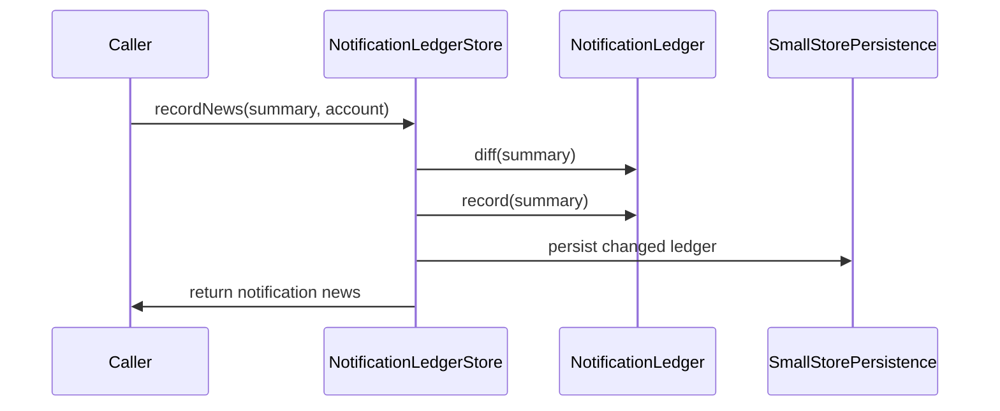

# PR #358: LOT-091: notification ledger (already-notified state per account)

- State: closed (merged)
- Author: ezzz · created 2026-11-01T09:13:58Z · updated 2026-11-01T12:55:35Z
- Labels: —
- Source: https://github.com/ezzz/HFRnow/pull/358
- Branch: ezzz:lot/091-notification-ledger → dev-swift · head 82043e78b79e692725579bceb29315358a66ebca
- Merged as af3275f4ef2cc98d5b645ddffd119709c1be0efe on 2026-11-01T12:55:35Z

LOT-091
Closes #183
Refs #149
Claim: ext/ezzz-opus-1

**Problem.** FEAT-005 (proposed by Bybifok) needs to notify each new MP or flagged-topic post once. Legacy kept one global count (`nb_mp`, `MPBackgroundService.swift:93-101` @ `21173e77`), whatever the account, reset it to 0 above 1000 (so it notified at every check past that), and had no state for flags or a last check.

**Change.** In HFRStorage, on LOT-064's small-store core:
- `NotificationSummary` (input: unread count, unread conversations, flagged topics with their last post; **nil = no information**, never 0, LOT-047) and `NotificationNews` (output).
- `NotificationLedger`, a pure value per account: `diff(summary:)` returns only what was not recorded; `record(_:)` is idempotent; the count keeps legacy's rule (the count recorded is the baseline, 0 when never recorded); conversations and flags start from a baseline (the first check notifies none of them); flags keep each topic's latest last post, at most 500 topics; `isDue(now:minimumInterval:)` (boundary included, a future last check is due) and `markChecked(at:)`.
- `NotificationLedgerStore` (actor): ledgers keyed by account key (ADR 0013 §7, device-only per the ADR 0013 matrix), validated writes, `removeAccount`, LOT-064's failure rule.
- Spec `docs/lots/LOT-091-notification-ledger.md` (legacy file:line, edge cases, intentional differences); CHANGELOG-LEGACY #50. No HFR request, so no HFR-PROTOCOL subsection. LOT-092's `UpdateSummary` maps to `NotificationSummary` in the app (HFRStorage cannot import HFRClient).

**Tests.** `NotificationLedgerTests` (count rule and baseline, the >1000 case, conversations, flags later/equal/older, a topic listed twice, idempotence, absent parts, the 500 limit, `isDue` at, before and past the boundary, never checked, clock back, negative interval) and `NotificationLedgerStoreTests` (per account key, no save on a repeated record, invalid summaries, empty account, account removal, file round trip, unreadable store). Thirteen mutations, each failing named tests (listed in the spec). Full HFRKit suite green locally, SwiftLint strict clean, `check-lot-deps` 0 violations.

Author model: Opus 5.5 · reviewer: Fable 5.1 (§6). `CHANGELOG-LEGACY.md` is also appended by #354, #352, #350, #348, #332: the row number is fixed at merge time.

🤖 Generated with [Claude Code](https://claude.com/claude-code)

<!-- This is an auto-generated comment: release notes by coderabbit.ai -->

<!-- coderabbit-ai-generated:v1 -->

## Summary by CodeRabbit

* **New Features**
  * Notifications now track unread private messages separately for each account and report newly unread conversations and flagged-topic updates.
* **Improvements**
  * Previously recorded notifications are not repeated, and accounts with very large unread message counts avoid repeated alerts at every check.
  * Favorite topics are ordered consistently by forum category and topic number, with private messages listed after forum categories.

<!-- end of auto-generated comment: release notes by coderabbit.ai -->

## coderabbitai[bot] · 2026-11-01T09:14:06Z

<!-- coderabbit-ai-generated:v1 -->

<!-- This is an auto-generated comment: summarize by coderabbit.ai -->
<!-- review_stack_entry_start -->

<a href="https://app.coderabbit.ai/change-stack/ezzz/HFRnow/pull/358?scope=ghh_OusAJGA4HG8ljoOV0wJvVx8NmnZIjc2DdjmxOu0xZWA&amp;cs_source=review_comment"><picture><source media="(prefers-color-scheme: dark)" srcset="https://storage.googleapis.com/coderabbit_public_assets/review-stack-in-coderabbit-ui-dark.svg?v=3"><source media="(prefers-color-scheme: light)" srcset="https://storage.googleapis.com/coderabbit_public_assets/review-stack-in-coderabbit-ui.svg?v=3"></picture></a>

<!-- review_stack_entry_end -->
<!-- recent_review_start -->

No actionable comments were generated in the recent review.

<strong><picture></picture> Recent review info</strong>

<dl>
<dd>

<!-- review_info_content -->

<strong><picture><source media="(prefers-color-scheme: dark)" srcset="https://storage.googleapis.com/coderabbit_public_assets/review-comment-icons-v1/cog-dark.svg"></picture> Run configuration</strong>

<dl>
<dd>

- **Source mode**: Auto
- **Repository**: [ezzz/HFRnow](<https://github.com/ezzz/HFRnow>)
- **Branch**: [lot/091-notification-ledger](<https://github.com/ezzz/HFRnow/tree/lot%2F091-notification-ledger>)
- **File**: [.coderabbit.yaml](<https://github.com/ezzz/HFRnow/blob/82043e78b79e692725579bceb29315358a66ebca/.coderabbit.yaml>)
- **Commit**: [82043e7](<https://github.com/ezzz/HFRnow/commit/82043e78b79e692725579bceb29315358a66ebca>)
- **Layers**: Repository YAML
- **Review profile**: ASSERTIVE
- **Plan**: Advanced
- **Run ID**: `306aa588-dcc4-4a19-bde3-f54c8579d2d7`

</dd>
</dl>

<strong><picture><source media="(prefers-color-scheme: dark)" srcset="https://storage.googleapis.com/coderabbit_public_assets/review-comment-icons-v1/git-commit-horizontal-dark.svg"></picture> Commits</strong>

<dl>
<dd>

Reviewing files that changed from the base of the PR and between 6140fe236ec861a5310c9b05d53758280ddd9ce3 and 82043e78b79e692725579bceb29315358a66ebca.

</dd>
</dl>

<strong><picture><source media="(prefers-color-scheme: dark)" srcset="https://storage.googleapis.com/coderabbit_public_assets/review-comment-icons-v1/file-plus-corner-dark.svg"></picture> Files selected for processing: 12</strong>

<dl>
<dd>

* `Packages/HFRKit/Sources/HFRStorage/SmallStores/Core/TopicOrder.swift`
* `Packages/HFRKit/Sources/HFRStorage/SmallStores/NotificationLedger/NotificationLedger.swift`
* `Packages/HFRKit/Sources/HFRStorage/SmallStores/NotificationLedger/NotificationLedgerDocument.swift`
* `Packages/HFRKit/Sources/HFRStorage/SmallStores/NotificationLedger/NotificationLedgerStore.swift`
* `Packages/HFRKit/Sources/HFRStorage/SmallStores/NotificationLedger/NotificationNews.swift`
* `Packages/HFRKit/Sources/HFRStorage/SmallStores/NotificationLedger/NotificationSummary.swift`
* `Packages/HFRKit/Sources/HFRStorage/SmallStores/SuperFavorites/SuperFavoritesStore.swift`
* `Packages/HFRKit/Tests/HFRStorageTests/SmallStores/NotificationLedgerStoreTests.swift`
* `Packages/HFRKit/Tests/HFRStorageTests/SmallStores/NotificationLedgerTests.swift`
* `Packages/HFRKit/Tests/HFRStorageTests/SmallStores/SmallStoreFailureTests.swift`
* `docs/CHANGELOG-LEGACY.md`
* `docs/lots/LOT-091-notification-ledger.md`

</dd>
</dl>

**Included review availability:** This review used your included allowance. Your plan provides up to 10 included reviews per hour; 9 remain after this review.

</dd>
</dl>

<!-- recent_review_end -->
<!-- walkthrough_start -->

<strong>Walkthrough</strong>

<dl>
<dd>

This change adds per-account notification summaries, ledger rules, and actor-backed persistence. It also introduces shared topic ordering and uses it to sort SuperFavorites.

**Changes: Notification ledger**

|Layer / File(s)|Summary|
|:---|:---|
|**Ledger data and notification rules**   `Packages/HFRKit/Sources/HFRStorage/SmallStores/Core/TopicOrder.swift`, `Packages/HFRKit/Sources/HFRStorage/SmallStores/NotificationLedger/*`, `Packages/HFRKit/Sources/HFRStorage/SmallStores/SuperFavorites/SuperFavoritesStore.swift`, `Packages/HFRKit/Tests/HFRStorageTests/SmallStores/NotificationLedgerTests.swift`, `docs/lots/LOT-091-notification-ledger.md`, `docs/CHANGELOG-LEGACY.md`|Adds summary and news types, per-account ledger diff and recording rules, check timing, topic ordering, and tests for these behaviors. `SuperFavoritesStore` uses the shared topic ordering.|
|**Account storage and atomic operations**   `Packages/HFRKit/Sources/HFRStorage/SmallStores/NotificationLedger/NotificationLedgerDocument.swift`, `Packages/HFRKit/Sources/HFRStorage/SmallStores/NotificationLedger/NotificationLedgerStore.swift`, `Packages/HFRKit/Tests/HFRStorageTests/SmallStores/NotificationLedgerStoreTests.swift`, `Packages/HFRKit/Tests/HFRStorageTests/SmallStores/SmallStoreFailureTests.swift`, `docs/lots/LOT-091-notification-ledger.md`|Adds a versioned account-keyed document and actor operations for recording news, scheduling checks, removing accounts, and handling store failures. Tests cover account isolation, concurrent calls, persistence, and unreadable data.|

<!-- change_assessment_start -->
**Estimated code review effort:** 3 (Moderate) | ~25 minutes

<!-- change_assessment_commit:"82043e78b79e692725579bceb29315358a66ebca" -->
<!-- change_assessment_priority:{"version":1,"urgency":"p2","manual":false} -->
**Change:** Feature
<!-- change_assessment_end -->

### Sequence Diagram(s)

**Possibly related issues**
- ezzz/HFRnow#145 — The ledger provides per-account unread-message and flagged-topic diffs, but this change does not implement the Home view.

**Suggested reviewers:** `moust4ki`

</dd>
</dl>

<!-- walkthrough_end -->

<strong>Merge Risk:</strong> <strong><picture></picture> Minimal</strong> · up to <code>82043</code>

<dl>
<dd>

<!-- final_review_risk_start -->
<!-- final_review_risk_label
**Merge Risk:** **⚪ Minimal** · up to `82043`
-->
<!-- final_review_risk_coverage:{"sourceCommitId":"82043e78b79e692725579bceb29315358a66ebca","coveredCommitId":"82043e78b79e692725579bceb29315358a66ebca","kind":"reviewed"} -->

No actionable issue remains that should delay merging after normal checks.
<!-- final_review_risk_end -->

</dd>
</dl>

<strong>Security architecture risk:</strong> <strong><picture></picture> Low</strong> · up to <code>82043</code>

<dl>
<dd>

<!-- architecture_review_start -->
<!-- architecture_review_label
### Security Architecture Review

**Security architecture risk:** **🔵 Low** · up to `82043`
-->

The change is confined to reusable storage code, with no production notification flow connected yet. Account-key normalization, serialized updates, and failure-preserving persistence limit current exposure. Authenticated account selection, device-local storage placement, and coordination across background callers remain responsibilities of the eventual integration.

**Retained concerns**
No architecture-level concerns identified.

<strong>Security review details</strong>

<dl>
<dd>

**Security Blast Radius**
- _inferred_ — The current affected asset is notification metadata for accounts sharing one injected ledger document. Account operations target normalized keys, but persistence failure or explicit unreadable-document recovery affects the whole document. The observed change adds no credential, IAM, network, or service authority.

**Trust Boundaries and Controls**
- _observed_ — The summary boundary distinguishes unknown information from zero, rejects negative counts and nonpositive thread/topic identifiers, and preserves omitted fields. Flag history is bounded to 500 stored topics, but this is not an overall input-size limit: unread-thread sets and incoming flag lists have no explicit cardinality bound here.

**Resilience and Maintainability Implications**
- _observed_ — Due-check coordination is per actor instance and uses a caller-provided interval and timestamp. Zero or negative intervals can permit repeated true results, including without a changed timestamp; a future last-check time is deliberately treated as due. This is scheduling state, not a durable exclusive lease across callers or processes.

**Hardening Proposals**
- _proposed_ — At application integration, bind account keys to authenticated account identity, use device-local persistence with one coordinated owner per document, and invalidate in-flight work when removing an account. Define delivery-failure behavior explicitly rather than relying on the ledger for exactly-once notification delivery.

</dd>
</dl>

<!-- architecture_review_end -->

</dd>
</dl>

<!-- pre_merge_checks_walkthrough_start -->

<strong>Pre-merge checks: <picture></picture> 4 · <picture></picture> 1</strong>

<dl>
<dd>

<strong><picture></picture> Failed checks: 1 warning</strong>

|         Check name         |                                              Status                                              | Explanation                                                                                                                                                                                               | Resolution                                                                                                                                                                                           |
| :------------------------ | :----------------------------------------------------------------------------------------------: | :-------------------------------------------------------------------------------------------------------------------------------------------------------------------------------------------------------- | :--------------------------------------------------------------------------------------------------------------------------------------------------------------------------------------------------- |
| Out of Scope Changes check |  | The `TopicOrder` addition and the `SuperFavoritesStore` ordering refactor are unrelated to issue `#183`. The notification ledger does not use `TopicOrder`, and these changes alter only SuperFavorites or… | Remove the `TopicOrder` and `SuperFavoritesStore` changes from this pull request, or provide a direct notification-ledger requirement that they implement. Submit the unrelated refactor separately. |

<strong><picture></picture> Passed checks: 4 passed</strong>

<dl>
<dd>

|      Check name     |                                             Status                                             | Explanation                                                                                                                                                                                               |
| :----------------- | :--------------------------------------------------------------------------------------------: | :-------------------------------------------------------------------------------------------------------------------------------------------------------------------------------------------------------- |
|  Description Check  |  | Check skipped - CodeRabbit’s high-level summary is enabled.                                                                                                                                               |
|     Title check     |  | The title clearly identifies the main change: a per-account notification ledger that tracks already-notified state.                                                                                       |
| Linked Issues check |  | Issue `#183` coding requirements are implemented. `NotificationLedger` provides per-account news diffs, idempotent recording, baselines, validation, flag limits, and due-date handling. `NotificationLedg… |
|  Docstring Coverage |  | Docstring coverage is 81.25% which is sufficient. The required threshold is 80.00%. Docstring coverage is scoped to functions touched by this diff with cyclomatic complexity of at least 2. Documentati… |

<strong>Full details: Linked Issues check</strong>

<dl>
<dd>

**Explanation**

Issue `#183` coding requirements are implemented. `NotificationLedger` provides per-account news diffs, idempotent recording, baselines, validation, flag limits, and due-date handling. `NotificationLedgerStore` provides actor-isolated atomic operations, account removal, persistence, and LOT-064 failure behavior. Swift Testing coverage includes the required ledger, store, persistence, validation, concurrency, and due-date cases. The spec documents legacy sources, edge cases, intentional differences, and the device-only storage decision. The reported Linux and macOS test coverage and architecture checks satisfy the remaining acceptance criteria. No HFR protocol facts are used, so the spec's explicit no-HFR-PROTOCOL decision is applicable.

</dd>
</dl>

<strong>Full details: Docstring Coverage</strong>

<dl>
<dd>

**Explanation**

Docstring coverage is 81.25% which is sufficient. The required threshold is 80.00%. Docstring coverage is scoped to functions touched by this diff with cyclomatic complexity of at least 2. Documentation-only edits and deletions within surviving functions are included; unchanged diff context and fully deleted functions are excluded. Analyzed 16 functions across 10 files. (2 skipped: 2 unsupported.)

</dd>
</dl>

</dd>
</dl>

<strong>Full details: Out of Scope Changes check</strong>

<dl>
<dd>

**Explanation**

The `TopicOrder` addition and the `SuperFavoritesStore` ordering refactor are unrelated to issue `#183`. The notification ledger does not use `TopicOrder`, and these changes alter only SuperFavorites ordering implementation. The linked issue scopes the work to notification-ledger value logic and persistence.

**Resolution**

Remove the `TopicOrder` and `SuperFavoritesStore` changes from this pull request, or provide a direct notification-ledger requirement that they implement. Submit the unrelated refactor separately.

</dd>
</dl>

</dd>
</dl>

<!-- pre_merge_checks_walkthrough_end -->
<!-- finishing_touch_checkbox_start -->

<strong>Finishing Touches</strong>

<dl>
<dd>

<strong>Generate docstrings</strong>

<dl>
<dd>

- [ ] <!-- {"checkboxId":"3e1879ae-f29b-4d0d-8e06-d12b7ba33d98"} --> Commit to this branch
- [ ] <!-- {"checkboxId":"7962f53c-55bc-4827-bfbf-6a18da830691"} --> Create a new PR

</dd>
</dl>

<strong>Generate unit tests (beta)</strong>

<dl>
<dd>

- [ ] <!-- {"checkboxId": "6ba7b810-9dad-11d1-80b4-00c04fd430c8", "radioGroupId": "utg-output-choice-group-unknown_comment_id"} --> Commit to this branch
- [ ] <!-- {"checkboxId": "f47ac10b-58cc-4372-a567-0e02b2c3d479", "radioGroupId": "utg-output-choice-group-unknown_comment_id"} --> Create a new PR

</dd>
</dl>

</dd>
</dl>

<!-- finishing_touch_checkbox_end -->

<!-- autopilot:start -->
- [ ] <!-- {"checkboxId":"2708ad07-9f24-4260-9c11-7dc76a49f2e3"} --> <strong title="Keep fixing CodeRabbit findings and required CI, and resolving merge conflicts">Autofix</strong> · Keep fixing CodeRabbit findings and required CI, and resolving merge conflicts
<!-- autopilot:end -->

## ezzz · 2026-11-01T12:32:36Z

**Adversarial review (Fable 5.1, independent of the author): REQUEST CHANGES** — head a9032825af5a994fcae7e6034e9819d9d4c80042

Checked: 16 tests green, `swiftlint --strict` clean, `check-lot-deps` 0; two mutations (`isDue` `>=`→`>`, absent flag not news) fail the named tests; every legacy citation (`MPBackgroundService.swift:37,73-74,93-101,94`, `HFRplusAppDelegate.m:221-222,253-259,485,706`, `MPListView.swift:442`) resolves at `21173e77`; account key, removal, LOT-064 failure rule, exact date round trip and `isDue` boundary/clock-back are correct. Tree restored (`git status`: only `.claude/`, `Carthage/`, `plugins/`).

1. **Medium** — `NotificationLedger.swift:43-47, 109-117`. "A topic absent from the record is news" produces false notifications. (a) Beyond `topicLimit`, `kept` evicts the oldest-last-post topic; the next check lists it again unchanged and it is news; with >500 flags that is one false notification per check, forever (the spec calls it "news again" as if intended). (b) HFR flags a topic when the member posts, so its `lastPost` is the member's own reply: unless LOT-092 maps only rows with `readState == .unread` (LOT-024), every reply the member writes is notified at the next check. Fix: keep a watermark (oldest `lastPost` kept after eviction; an unrecorded topic is news only when `lastPost > watermark`), and pin in `NotificationSummary`'s doc and the spec which rows the summary carries.

2. **Medium** — `NotificationLedgerStore.swift`. No compound operation: `ledger(for:)`→`isDue`→`markChecked` and `diff`→`record` are separate actor calls. A Home refresh (LOT-092 consumer, recording what it showed) and the intent (LOT-141), or two overlapping intent runs, both read "due"/the same news and notify twice, which is #183's acceptance criterion. Fix: `markCheckedIfDue(account:now:minimumInterval:) throws(SmallStoreError) -> Bool` and `recordNews(_:account:) throws(SmallStoreError) -> NotificationNews`, each inside one `state.mutate`; or state in the spec that callers serialize checks per account.

3. **Low** — spec §Edge cases / `NotificationSummary.swift:296-301`. `LastPost.date` is optional in HFRModels, `FlaggedTopicStamp.lastPost` is not: say what the mapping does with an undatable last post (dropped, hence never notified).

4. **Low** — spec §Intentional differences 3. "Legacy only stored a parsed count too" holds for the Swift port (`extractMPCount` nil, `:91`) but not for the ObjC path the table also cites: `HFRplusAppDelegate.m:243-259` stores `intValue` of the raw text (0 on a logged-out home), resetting the baseline and re-notifying everything afterwards. Record it; it strengthens the difference.

5. **Low** — spec. No word on LOT-140's kept legacy BGTask (`nb_mp`): two notifiers for one MP unless it reads this ledger. Add a line and note it on #230.

6. **nit** — `NotificationLedger.swift:25`: `Set<Int>` encodes in nondeterministic order (LOT-064 stores save sorted); store a sorted array.

7. **nit** — value-level `record` accepts a negative count (only the store validates), so `diff` inflates `count − (−n)`; validate in the value or document the store as the only writer.

8. **nit** — `SmallStoreFailureTests.aCorruptFileIsKeptByEveryStore`: add the new store. `rank(of:)` duplicates `SuperFavoritesStore`'s. Spec "Depends on LOT-013 (TopicID)": `TopicID` is LOT-010 (LOT-090 spec).

## ezzz · 2026-11-01T12:35:18Z

Review round 1, fixed in 8603c66:
1. Fixed (a): `flagWatermark`, the latest last post among topics dropped by the limit; a topic not recorded is news only after it. `theOldestFlaggedTopicsAreDroppedBeyondTheLimit` now checks the dropped topic unchanged (no news), with a later post (news), and a never-recorded topic before/after the watermark. (b): `NotificationSummary.flaggedTopics` and the spec say the caller passes only rows LOT-024 reads as unread. I did not write that HFR flags a topic when the member posts: no capture or legacy line says so in HFR-PROTOCOL, so the doc only says a read row has nothing to notify.
2. Fixed: `markCheckedIfDue(account:now:minimumInterval:)` and `recordNews(_:account:)`, each one `state.mutate`; `overlappingChecksGetTheNewsAndTheTurnOnce` runs two of each concurrently. The spec states the guarantee and that read-then-write in two calls has none.
3. Fixed: undatable last post left out (summary doc and spec).
4. Fixed: intentional difference 3 now cites the ObjC `intValue` path (`HFRplusAppDelegate.m:243-259`).
5. Fixed: spec line on LOT-140; noted on #230.
6. Fixed: `unreadThreads` is a sorted `[Int]` (`conversationsAreStoredSorted`).
7. Fixed: the value's `diff` and `record` ignore an invalid summary (`anInvalidSummaryIsNeitherNewsNorRecorded`); a negative stored count reads as 0.
8. Fixed: the store is in `aCorruptFileIsKeptByEveryStore`; `TopicOrder` (SmallStores/Core) replaces both `rank(of:)` copies; `TopicID` credited to LOT-010.
Each new guard was mutated and fails its named test (spec, Tests).

## ezzz · 2026-11-01T12:38:04Z

**Adversarial review (Fable 5.1, independent of the author), re-check: REQUEST CHANGES** — head 8603c66e992eea9973d00661e1ffe835a1eaf9c0

Checked at 8603c66: 39 tests green across `NotificationLedger*`, `SmallStoreFailure`, `SuperFavorites`; `swiftlint --strict` clean; `check-lot-deps` 0; tree untouched (`git status`: only `.claude/`, `Carthage/`, `plugins/`). Findings 1(a), 2–8 of round 1 are fixed as described: the watermark is the latest dropped last post, raised only on eviction, and an unrecorded topic is news only strictly after it (a dropped row re-listed unchanged is not news, `diff` on a never-recorded ledger stays empty); `markCheckedIfDue` and `recordNews` each decide and write in one `state.mutate`, and when `diff` is non-empty `record` always changes the ledger, so no news is returned unsaved; invalid summaries are inert at the value level; `TopicOrder` keeps `SuperFavoritesStore`'s order.

1. **Medium** — `NotificationSummary.swift:13-16` and spec "Which flag rows". The gate "only rows LOT-024 reads as unread (`readState == .unread`)" names a value the flags page never yields: `FavoritesParser.swift:76` sets every `FavoritesPage` row to `.unknown`, on purpose (LOT-024 spec, `topics` row: legacy's "viewed unless flagged" is not what the page says), and the only capture, R10, shows `closedb_new.gif` `alt="On"` on both rows, so whether `sujetCase1` means anything on `forum1f.php` is not established (HFR-PROTOCOL §LOT-022 notes anonymous lists show "On" on every row). LOT-092 cannot honour this contract, and AGENTS §3.1 forbids asserting it. Fix (docs only): say the caller passes the rows it has evidence of unread posts for, state that no row of the flags page carries that evidence today, list the capture that would settle it (a logged-in `owntopic=1` page with one read and one unread topic, on #109 / CAP-N5 #173), and keep the ledger's date rule as the only de-duplication until then. On 1(b): I have no legacy line or capture saying a post creates a flag; the neutral wording ("a read row has nothing to notify") is right, only its `.unread` anchor is wrong.

No other findings.

## ezzz · 2026-11-01T12:39:04Z

**Adversarial review (Fable 5.1, independent of the author), confirmation: APPROVE** — head 82043e78b79e692725579bceb29315358a66ebca

Confirmed on 82043e78 (docs only since 8603c66: `NotificationSummary.flaggedTopics` doc comment and the spec's "Which flag rows"). The wording no longer asserts a `.unread` gate: it says the summary carries the flagged topics the check listed, that a row with evidence of being read may be left out, that the flags page gives none today, and names the pending capture. Each fact checks out: `FavoritesParser.swift:76` sets `.unknown` and LOT-024 D1 records why; the R10 fixture shows `closedb_new.gif` with `alt="On"` and `title="Nouveau message"` on both rows; #109 / CAP-N5 #173 are the open capture issues. The date rule as the only de-duplication, with "a post already read can be notified once", is stated honestly. `swiftlint --strict` clean on the head; code unchanged since the round-2 run (39 tests green). Tree untouched.

No findings.

## ezzz · 2026-11-01T12:55:32Z

READY FOR REVIEW — merge-ready at 82043e78b79e692725579bceb29315358a66ebca. Author model: Opus 5.5.
