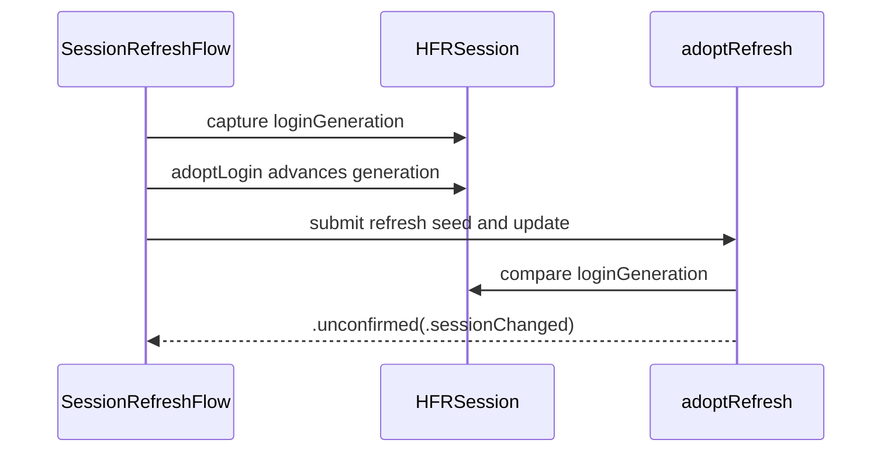

# PR #406: [SwiftHFR] #340: fence token writes with a login generation (same-account re-login)

- State: closed (merged)
- Author: francoisgn · created 2026-11-02T09:03:06Z · updated 2026-11-11T21:14:00Z
- Labels: —
- Source: https://github.com/ezzz/HFRnow/pull/406
- Branch: ezzz:fix/340-refresh-login-generation → dev-swift · head 0b43d9e65fc57ad80aca1107bf7bfcf12dde9e69
- Merged as c2de927bcf38fd619cde306bcb38a6e72d3606ab on 2026-11-02T11:21:42Z

Closes #340
Claim: cloud/i340

**Problem.** `adoptRefresh` (LOT-044) and `HashCheckSeed.updateHashCheck(_:since:)` (#308) only compare identity and token with their seed. A re-login of the **same** account that installs the seed's own token, landing while a refresh or a form/flag GET is in flight, passes both checks: the token read with the old cookies overwrites the login's, and the next POST gets HFR's bad-token answer (`W17b`).

**Cause.** Identity + token cannot tell "nothing happened" from "same account, same token, new cookies".

**Change.**
- `HFRSession.loginGeneration` (public read-only) + `advanceLoginGeneration()` (HFRNetwork); `adoptLogin` advances it after installing cookies and token.
- `RefreshSeed` carries it; `adoptRefresh` returns `.unconfirmed(.sessionChanged)` and writes nothing (cookies nor token) when it moved.
- #315 is merged, so `HashCheckSeed` uses the same generation (`PostingSession` gains `loginGeneration`): one fence for every token write, as the issue suggested.
- LOT-043 / LOT-044 specs describe the fence. No HFR fact added (HFR-PROTOCOL unchanged).

Nothing wider: cookie compare-and-set was already safe; no app change.

Heads-up for open PRs with their own `PostingSession` test fakes: they need `var loginGeneration: Int` (a stored `0` is enough).

**Tests** (`swift test` 1275/1275 on Linux, SwiftLint clean, `check-lot-deps.py` 0 violations):
- `SessionRefreshFlowTests.sameAccountReloginWithTheSameTokenDuringTheRefreshWins`: real `HFRSession`, `adoptLogin` of the same account with the seed's token during the probe, refresh carries another token → `.unconfirmed(.sessionChanged)`, login's cookies and token kept, generation 1.
- `ConcurrentLoginTokenTests.changeAfterSeedWins("relogin-same-token")` on a real `HFRSession`, and `markReadKeepsFresherToken` with a same-account same-token login (R21).
- Shown to fail without the change: with `advanceLoginGeneration()` (and the fake's increment) commented out, 7 issues across both suites. Existing LOT-044 tests unchanged and green.

---
_Generated by [Claude Code](https://claude.ai/code/session_014QH2CE39ZJW9BYAsdwDWok)_

<!-- This is an auto-generated comment: release notes by coderabbit.ai -->

<!-- coderabbit-ai-generated:v1 -->

## Summary by CodeRabbit

* **Bug Fixes**
  * Login sessions now retain the latest cookies and token when an earlier request or refresh finishes after a re-login—even when the account and token are unchanged.
  * Page-token updates from requests started before a re-login are no longer applied to the newer session.
  * Refresh results are marked unconfirmed if the session changes during the refresh.

* **Documentation**
  * Updated session and login guidance to describe how re-logins affect in-flight requests and refreshes.

<!-- end of auto-generated comment: release notes by coderabbit.ai -->

## coderabbitai[bot] · 2026-11-02T09:03:15Z

<!-- coderabbit-ai-generated:v1 -->

<!-- This is an auto-generated comment: summarize by coderabbit.ai -->
<!-- review_stack_entry_start -->

<a href="https://app.coderabbit.ai/change-stack/ezzz/HFRnow/pull/406?scope=ghh_OusAJGA4HG8ljoOV0wJvVx8NmnZIjc2DdjmxOu0xZWA&amp;cs_source=review_comment"><picture><source media="(prefers-color-scheme: dark)" srcset="https://storage.googleapis.com/coderabbit_public_assets/review-stack-in-coderabbit-ui-dark.svg?v=3"><source media="(prefers-color-scheme: light)" srcset="https://storage.googleapis.com/coderabbit_public_assets/review-stack-in-coderabbit-ui.svg?v=3"></picture></a>

<!-- review_stack_entry_end -->
<!-- recent_review_start -->

No actionable comments were generated in the recent review.

<strong><picture></picture> Recent review info</strong>

<dl>
<dd>

<!-- review_info_content -->

<strong><picture><source media="(prefers-color-scheme: dark)" srcset="https://storage.googleapis.com/coderabbit_public_assets/review-comment-icons-v1/cog-dark.svg"></picture> Run configuration</strong>

<dl>
<dd>

- **Source mode**: Auto
- **Repository**: [ezzz/HFRnow](<https://github.com/ezzz/HFRnow>)
- **Branch**: [fix/340-refresh-login-generation](<https://github.com/ezzz/HFRnow/tree/fix%2F340-refresh-login-generation>)
- **File**: [.coderabbit.yaml](<https://github.com/ezzz/HFRnow/blob/0b43d9e65fc57ad80aca1107bf7bfcf12dde9e69/.coderabbit.yaml>)
- **Commit**: [0b43d9e](<https://github.com/ezzz/HFRnow/commit/0b43d9e65fc57ad80aca1107bf7bfcf12dde9e69>)
- **Layers**: Repository YAML
- **Review profile**: ASSERTIVE
- **Plan**: Advanced
- **Run ID**: `cfa60f24-b77f-4597-beef-386e63ae6f47`

</dd>
</dl>

<strong><picture><source media="(prefers-color-scheme: dark)" srcset="https://storage.googleapis.com/coderabbit_public_assets/review-comment-icons-v1/git-commit-horizontal-dark.svg"></picture> Commits</strong>

<dl>
<dd>

Reviewing files that changed from the base of the PR and between c8bb09b8f477fc359600dc3e68bbdba2921b4c47 and 0b43d9e65fc57ad80aca1107bf7bfcf12dde9e69.

</dd>
</dl>

<strong><picture><source media="(prefers-color-scheme: dark)" srcset="https://storage.googleapis.com/coderabbit_public_assets/review-comment-icons-v1/file-plus-corner-dark.svg"></picture> Files selected for processing: 13</strong>

<dl>
<dd>

* `Packages/HFRKit/Sources/HFRClient/Login/HFRSession+Login.swift`
* `Packages/HFRKit/Sources/HFRClient/Posting/HashCheckSeed.swift`
* `Packages/HFRKit/Sources/HFRClient/Posting/PostingSession.swift`
* `Packages/HFRKit/Sources/HFRClient/Session/RefreshUpdate.swift`
* `Packages/HFRKit/Sources/HFRClient/Session/SessionHealth.swift`
* `Packages/HFRKit/Sources/HFRNetwork/Session/HFRSession.swift`
* `Packages/HFRKit/Tests/HFRClientTests/Session/ConcurrentLoginTokenTests.swift`
* `Packages/HFRKit/Tests/HFRClientTests/Session/SessionRefreshFlowTests.swift`
* `Packages/HFRKit/Tests/HFRClientTests/Support/ScriptedFlagSession.swift`
* `Packages/HFRKit/Tests/HFRClientTests/Support/ScriptedPostingSession.swift`
* `docs/lots/LOT-042-sessions.md`
* `docs/lots/LOT-043-login.md`
* `docs/lots/LOT-044-session-health.md`

</dd>
</dl>

**Included review availability:** This review used your included allowance. Your plan provides up to 10 included reviews per hour; 5 remain after this review.

</dd>
</dl>

<!-- recent_review_end -->
<!-- walkthrough_start -->

<strong>Walkthrough</strong>

<dl>
<dd>

The change adds a login-generation counter to `HFRSession`. Refresh and posting operations capture that counter and reject writes after a relogin, including a same-account relogin with the same token. Tests and LOT documentation cover the behavior.

**Changes: Login generation and adoption fences**

|Layer / File(s)|Summary|
|:---|:---|
|**Generation API and login adoption**   `Packages/HFRKit/Sources/HFRNetwork/Session/HFRSession.swift`, `Packages/HFRKit/Sources/HFRClient/Login/HFRSession+Login.swift`, `Packages/HFRKit/Sources/HFRClient/Posting/PostingSession.swift`|`HFRSession` exposes `loginGeneration` and `advanceLoginGeneration()`. `adoptLogin` advances the generation after installing login state.|
|**Refresh and posting seed checks**   `Packages/HFRKit/Sources/HFRClient/Session/RefreshUpdate.swift`, `Packages/HFRKit/Sources/HFRClient/Posting/HashCheckSeed.swift`, `Packages/HFRKit/Sources/HFRClient/Session/SessionHealth.swift`|Refresh and posting seeds capture `loginGeneration`. Refresh adoption returns `.unconfirmed(.sessionChanged)` when the generation changes.|
|**Concurrent-login tests and LOT updates**   `Packages/HFRKit/Tests/HFRClientTests/Session/*`, `Packages/HFRKit/Tests/HFRClientTests/Support/*`, `docs/lots/LOT-042-sessions.md`, `docs/lots/LOT-043-login.md`, `docs/lots/LOT-044-session-health.md`|Tests cover same-account relogins during posting and refresh. Support sessions track generation changes, and LOT specifications document the fence.|

<!-- change_assessment_start -->
**Estimated code review effort:** 3 (Moderate) | ~20 minutes

<!-- change_assessment_commit:"0b43d9e65fc57ad80aca1107bf7bfcf12dde9e69" -->
<!-- change_assessment_priority:{"version":1,"urgency":"p2","manual":false} -->
**Change:** Bug fix · **Severity of issue fixed:** Medium
<!-- change_assessment_end -->

### Sequence Diagram(s)

**Possibly related issues**

- ezzz/HFRnow issue 342: The PR fences stale token writes but does not add the separate local refusal for stale `PostingForm` state.
- ezzz/HFRnow issue 216: The PR applies the generation fence to flag token writes and tests that `markRead` retains the fresher token.

</dd>
</dl>

<!-- walkthrough_end -->

<strong>Merge Risk:</strong> <strong><picture></picture> Minimal</strong> · up to <code>0b43d</code>

<dl>
<dd>

<!-- final_review_risk_start -->
<!-- final_review_risk_label
**Merge Risk:** **⚪ Minimal** · up to `0b43d`
-->
<!-- final_review_risk_coverage:{"sourceCommitId":"0b43d9e65fc57ad80aca1107bf7bfcf12dde9e69","coveredCommitId":"0b43d9e65fc57ad80aca1107bf7bfcf12dde9e69","kind":"reviewed"} -->

Re-logging in as the same account while a refresh or posting request is in flight no longer lets the older request overwrite the new login's token. The change is limited to the HFRKit package, and no concrete merge-blocking defect was found in the supplied code or tests.
<!-- final_review_risk_end -->

</dd>
</dl>

<strong>Security architecture risk:</strong> <strong><picture></picture> Minimal</strong> · up to <code>0b43d</code>

<dl>
<dd>

<!-- architecture_review_start -->
<!-- architecture_review_label
### Security Architecture Review

**Security architecture risk:** **⚪ Minimal** · up to `0b43d`
-->

The change strengthens protection against stale requests overwriting a newer login’s credentials. The reviewed paths preserve existing identity checks and account isolation, with no material security risk found to be introduced or worsened.

**Retained concerns**
No architecture-level concerns identified.

<strong>Security review details</strong>

<dl>
<dd>

**Security Blast Radius**
- _inferred_ — The changed state and rejection behavior are scoped to the referenced HFRSession instance. Existing private cookie storage, disabled shared cache and credential storage, and host restrictions remain the containment controls; the generation introduces no cross-account credential authority.

**Security Findings and Attack Paths**
- _observed_ — A residual behavior predates this PR: loadForm ignores a rejected session-token update and returns the fetched form, whose stored token can later be serialized into a POST. Full-base comparison confirms that form creation, serialization, and submission are unchanged. This limits the fence to session-state adoption; it does not establish a newly introduced authorization bypass.

**Trust Boundaries and Controls**
- _observed_ — A refresh response cannot overwrite login-owned state after generation movement. Adoption checks cancellation, current identity, and generation before any writes. Posting token adoption likewise compares identity, token, and generation in one actor-isolated operation.

**Resilience and Maintainability Implications**
- _observed_ — Flag operations requiring a session check send nothing unless refresh reports valid, so the new sessionChanged rejection fails closed. Posting submission retains its existing single-send behavior and reports uncertain transport outcomes rather than automatically replaying a potentially completed write.

**Hardening Proposals**
- _proposed_ — As separate follow-up hardening, consider binding fetched posting forms to their login generation and rejecting stale forms before submission, requiring a fresh fetch rather than automatically replaying a POST.

</dd>
</dl>

<!-- architecture_review_end -->

</dd>
</dl>

<!-- pre_merge_checks_walkthrough_start -->

<strong>Pre-merge checks: <picture></picture> 3 · <picture></picture> 1 · <picture></picture> 1</strong>

<dl>
<dd>

<strong><picture></picture> Failed checks: 1 warning · 1 inconclusive</strong>

|      Check name     |                                                   Status                                                   | Explanation                                                                                                                                                                                               | Resolution                                                                         |
| :----------------- | :--------------------------------------------------------------------------------------------------------: | :-------------------------------------------------------------------------------------------------------------------------------------------------------------------------------------------------------- | :--------------------------------------------------------------------------------- |
|  Docstring Coverage |            | Docstring coverage is 50.00% which is insufficient. The required threshold is 80.00%. Docstring coverage is scoped to functions touched by this diff with cyclomatic complexity of at least 2. Documenta… | Write docstrings for the functions missing them to satisfy the coverage threshold. |
| Linked Issues check |  | The PR implements the coding requirements in `#340`. `HFRSession` has a read-only `loginGeneration`, `adoptLogin` advances it after installing cookies and the token, and `adoptRefresh` rejects a moved g… | Provide or verify the macOS `swift test` CI result for `#340`.                       |

<strong><picture></picture> Passed checks: 3 passed</strong>

<dl>
<dd>

|         Check name         |                                             Status                                             | Explanation                                                                                                                                                                                               |
| :------------------------ | :--------------------------------------------------------------------------------------------: | :-------------------------------------------------------------------------------------------------------------------------------------------------------------------------------------------------------- |
|      Description Check     |  | Check skipped - CodeRabbit’s high-level summary is enabled.                                                                                                                                               |
|         Title check        |  | The title names the main change: token writes are fenced with a login generation, and it cites the same-account re-login case. The changeset adds HFRSession.loginGeneration, advances it in adoptLogin,… |
| Out of Scope Changes check |  | The changed source, tests, session fakes, and LOT specifications support the login-generation fence requested by `#340`. The shared `HashCheckSeed` fence addresses the coordination explicitly requested … |

<strong>Full details: Title check</strong>

<dl>
<dd>

**Explanation**

The title names the main change: token writes are fenced with a login generation, and it cites the same-account re-login case. The changeset adds HFRSession.loginGeneration, advances it in adoptLogin, and carries it in RefreshSeed and HashCheckSeed so adoptRefresh returns .unconfirmed(.sessionChanged) when it moves. The title is specific, short, and in one sentence. The issue number prefix and the parenthetical are acceptable but add some length.

</dd>
</dl>

<strong>Full details: Out of Scope Changes check</strong>

<dl>
<dd>

**Explanation**

The changed source, tests, session fakes, and LOT specifications support the login-generation fence requested by `#340`. The shared `HashCheckSeed` fence addresses the coordination explicitly requested in `#340`. No unrelated application changes or HFR-PROTOCOL changes are shown.

</dd>
</dl>

</dd>
</dl>

<strong>Full details: Docstring Coverage</strong>

<dl>
<dd>

**Explanation**

Docstring coverage is 50.00% which is insufficient. The required threshold is 80.00%. Docstring coverage is scoped to functions touched by this diff with cyclomatic complexity of at least 2. Documentation-only edits and deletions within surviving functions are included; unchanged diff context and fully deleted functions are excluded. Analyzed 6 functions across 10 files. (3 skipped: 3 unsupported.)

**Resolution**

Write docstrings for the functions missing them to satisfy the coverage threshold.

</dd>
</dl>

<strong>Full details: Linked Issues check</strong>

<dl>
<dd>

**Explanation**

The PR implements the coding requirements in `#340`. `HFRSession` has a read-only `loginGeneration`, `adoptLogin` advances it after installing cookies and the token, and `adoptRefresh` rejects a moved generation without writes. `RefreshSeed` and `HashCheckSeed` carry the generation. The added real-session test covers a same-account, same-token re-login, and the reported Linux test run passed. The LOT-043 and LOT-044 specifications were updated, and HFR-PROTOCOL was not changed. The required macOS `swift test` result is not established by the supplied evidence.

**Resolution**

Provide or verify the macOS `swift test` CI result for `#340`.

</dd>
</dl>

</dd>
</dl>

<!-- pre_merge_checks_walkthrough_end -->
<!-- finishing_touch_checkbox_start -->

<strong>Finishing Touches</strong>

<dl>
<dd>

<strong>Generate docstrings</strong>

<dl>
<dd>

- [ ] <!-- {"checkboxId":"3e1879ae-f29b-4d0d-8e06-d12b7ba33d98"} --> Commit to this branch
- [ ] <!-- {"checkboxId":"7962f53c-55bc-4827-bfbf-6a18da830691"} --> Create a new PR

</dd>
</dl>

<strong>Generate unit tests (beta)</strong>

<dl>
<dd>

- [ ] <!-- {"checkboxId": "6ba7b810-9dad-11d1-80b4-00c04fd430c8", "radioGroupId": "utg-output-choice-group-unknown_comment_id"} --> Commit to this branch
- [ ] <!-- {"checkboxId": "f47ac10b-58cc-4372-a567-0e02b2c3d479", "radioGroupId": "utg-output-choice-group-unknown_comment_id"} --> Create a new PR

</dd>
</dl>

</dd>
</dl>

<!-- finishing_touch_checkbox_end -->

<!-- autopilot:start -->
- [ ] <!-- {"checkboxId":"2708ad07-9f24-4260-9c11-7dc76a49f2e3"} --> <strong title="Keep fixing CodeRabbit findings and required CI, and resolving merge conflicts">Autofix</strong> · Keep fixing CodeRabbit findings and required CI, and resolving merge conflicts
<!-- autopilot:end -->

## francoisgn · 2026-11-02T10:08:09Z

Ready to merge for cloud/orch

- Head: `0b43d9e65fc57ad80aca1107bf7bfcf12dde9e69`
- CI on head: all green (HFRKit Linux + macOS, App build + tests iOS 27, SwiftLint, Docs consistency, CodeQL swift/actions, gitleaks, dependency review)
- Adversarial review (Fable, author Opus): round 1 APPROVE on `e55cd50` with 5 minor doc findings → fixed in `0b43d9e` → APPROVE on `0b43d9e`, no new findings. Reviewer mutation runs: dropping either generation check fails exactly the new tests.
- CodeRabbit: reviewed `0b43d9e`, no actionable comments; 0 review threads open. (Docstring-coverage pre-merge warning only.)
- `Closes #340`, `Claim: cloud/i340`. Session/token flow: merge by cloud/orch or maintainer (AGENTS.md §8), then close #340 with `Done in #406 (merged as <sha>)`.
- Heads-up: `PostingSession` gains `var loginGeneration: Int`; open PRs with their own `PostingSession` test fakes need it after this lands.

---
_Generated by [Claude Code](https://claude.ai/code)_
