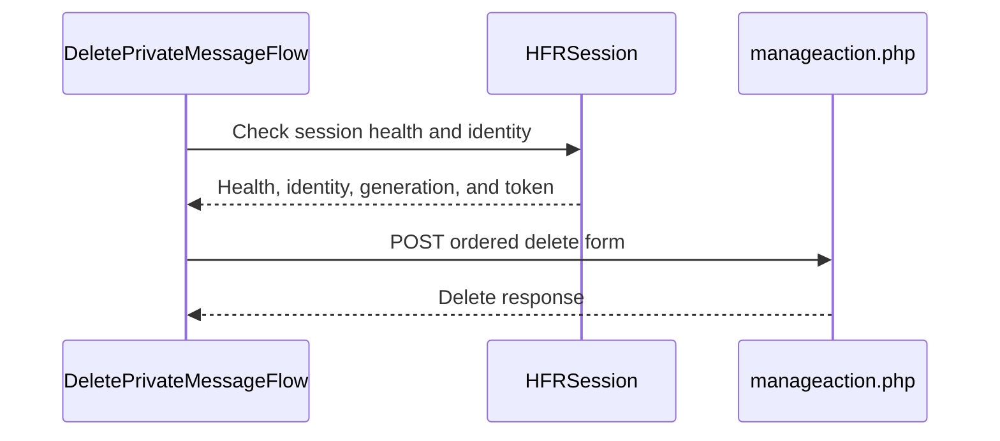

# PR #441: LOT-094: MP thread delete, confirmed by HFR's sentence and the MP list refresh

- State: closed (merged)
- Author: francoisgn · created 2026-11-02T16:24:08Z · updated 2026-11-02T20:51:00Z
- Labels: —
- Source: https://github.com/ezzz/HFRnow/pull/441
- Branch: ezzz:lot/094-mp-thread-delete → dev-swift · head bb34d0de5bef2db5ed883450cc2e9e15cc69879b
- Merged as b23bd6e351b54cd6c098067aa0a88b0ffbd5d469 on 2026-11-02T20:51:00Z

LOT-094
Closes #186
Claim: cloud/lot-094

**Problem.** No engine flow deletes an MP thread. Legacy's delete (`MPListView.swift:114-159` @ 03e5e22, not in 2440d79) calls any 2xx a success: the bad-token answer `W64x` is a 200, so a refused delete showed as done. It also posts with the app-wide `hash_check` and never checks the session.

**Change.**
- `DeletePrivateMessageFlow.delete(_:in:)` (HFRClient, new `MPDelete/`): one POST to the MP list form action (`R95k`), redirects not followed, with legacy's `valid_eff_prive` body in `W64`'s order, byte for byte.
- **Session gate** (as #314): LOT-044 `SessionRefreshFlow` first; anything but `.valid` sends nothing.
- **Login fence** (#340, #342): identity, token and `loginGeneration` are read before and after the check, each in one actor turn. Another account, a logout or a re-login (generation moved) gives `sessionChanged`, nothing sent. A token the refresh recorded is the one posted. #412 has not landed and brings no `send(since:)`, so the one actor hop between that read and the POST stays open. A login landing there sends this account's token with the other cookies; HFR refuses that (`W64x`) and nothing is deleted. Written in the spec.
- **Confirmation**: LOT-037 `.write` success **and** the whole sentence "Action effectuée avec succès" **and** a refresh to `/forum1.php` with exactly one `cat=prive` (`W64`, `W65`). The sentence names no action, hence the refresh check. `W64x` → `rejected`; logged out → `notLoggedIn`; other writes' confirmations → `unconfirmed(.unexpectedConfirmation)`; redirect, other page or failure after sending → `unconfirmed`.
- Docs: spec `docs/lots/LOT-094-mp-thread-delete.md` (pending capture: cookie-less or expired delete, repeated delete, a thread the account is not in), HFR-PROTOCOL §3 row cites 03e5e22, §6c `### LOT-094`, CHANGELOG-LEGACY row 59.

Scope: no `HFRModels` type changed. In the test support, `ScriptedFlagSession` gains `adoptLogin` and `adoptRefreshedToken` and the delete captures.

**Tests** (`swift test` after merging the latest `dev-swift`: 1344 tests, green; `swiftlint --strict` clean; `check-lot-deps.py` 0 violations)
- `DeletePrivateMessageFlowTests`:
  - The body equals `W64`'s `request_body` and `W64`/`W65`'s field list. The URL is `W64`'s. The fields are `R95k`'s `form1` controls except `type_page` and `topic_statusno1`.
  - `W64` and `W65` confirm. `W64x` is rejected and `W17c` is `notLoggedIn`.
  - `W18`, `P03j`, `P03d` and `W15` are unexpected confirmations. So is `W64` with 4 other refresh targets.
  - `R95j`, a redirect, a timeout and HTTP 500 are unconfirmed. A host refusal is `network`. Invalid threads send nothing.
- `DeletePrivateMessageSessionGateTests`:
  - Unconfirmed health or a failed check sends nothing.
  - A login during the check sends nothing: another account, the same one again, or a logout.
  - A refreshed token is the one sent. No token, or a cancelled task, sends nothing.
  - The public entry point runs on a loopback-only `HFRSession`. It sends nothing without a session, sends nothing on a login form, and is attempted (then stopped by the host policy) after the profile page.
- Shown to fail without the change. Without the sentence and refresh check, the 8 cases of the two "unexpected confirmation" tests fail. Without the fence, the 3 login-during-check cases fail.

**Coordination:** #412, #359 and #354 also add §6c subsections and CHANGELOG-LEGACY rows: whichever lands later renumbers its row.

**Review:** adversarial review by Fable pending.

---
_Generated by [Claude Code](https://claude.ai/code/session_014QH2CFoLuHr4qDvTp5z86y)_

<!-- This is an auto-generated comment: release notes by coderabbit.ai -->

<!-- coderabbit-ai-generated:v1 -->

## Summary by CodeRabbit

* **New Features**
  * Added the ability to delete a private-message thread from the selected account’s message list. Deletion is reported as successful only after the site confirms it and returns the user to the private-message list.
  * Requests are blocked when the thread is invalid or the selected account’s session cannot be confirmed, helping prevent accidental actions under the wrong account.
* **Bug Fixes**
  * Refusals and unclear responses are no longer treated as confirmed deletions.

<!-- end of auto-generated comment: release notes by coderabbit.ai -->

## coderabbitai[bot] · 2026-11-02T16:24:17Z

<!-- coderabbit-ai-generated:v1 -->

<!-- This is an auto-generated comment: summarize by coderabbit.ai -->
<!-- review_stack_entry_start -->

<a href="https://app.coderabbit.ai/change-stack/ezzz/HFRnow/pull/441?scope=ghh_OusAJGA4HG8ljoOV0wJvVx8NmnZIjc2DdjmxOu0xZWA&amp;cs_source=review_comment"><picture><source media="(prefers-color-scheme: dark)" srcset="https://storage.googleapis.com/coderabbit_public_assets/review-stack-in-coderabbit-ui-dark.svg?v=3"><source media="(prefers-color-scheme: light)" srcset="https://storage.googleapis.com/coderabbit_public_assets/review-stack-in-coderabbit-ui.svg?v=3"></picture></a>

<!-- review_stack_entry_end -->
<!-- recent_review_start -->

No actionable comments were generated in the recent review.

<strong><picture></picture> Recent review info</strong>

<dl>
<dd>

<!-- review_info_content -->

<strong><picture><source media="(prefers-color-scheme: dark)" srcset="https://storage.googleapis.com/coderabbit_public_assets/review-comment-icons-v1/cog-dark.svg"></picture> Run configuration</strong>

<dl>
<dd>

- **Source mode**: Auto
- **Repository**: [ezzz/HFRnow](<https://github.com/ezzz/HFRnow>)
- **Branch**: [lot/094-mp-thread-delete](<https://github.com/ezzz/HFRnow/tree/lot%2F094-mp-thread-delete>)
- **File**: [.coderabbit.yaml](<https://github.com/ezzz/HFRnow/blob/bb34d0de5bef2db5ed883450cc2e9e15cc69879b/.coderabbit.yaml>)
- **Commit**: [bb34d0d](<https://github.com/ezzz/HFRnow/commit/bb34d0de5bef2db5ed883450cc2e9e15cc69879b>)
- **Layers**: Repository YAML
- **Review profile**: ASSERTIVE
- **Plan**: Advanced
- **Run ID**: `4241c69f-3959-4c14-96f8-9ad2aba4a726`

</dd>
</dl>

<strong><picture><source media="(prefers-color-scheme: dark)" srcset="https://storage.googleapis.com/coderabbit_public_assets/review-comment-icons-v1/git-commit-horizontal-dark.svg"></picture> Commits</strong>

<dl>
<dd>

Reviewing files that changed from the base of the PR and between 011f87575a285cd994f5ca8bc6db2d498e7f5e67 and bb34d0de5bef2db5ed883450cc2e9e15cc69879b.

</dd>
</dl>

<strong><picture><source media="(prefers-color-scheme: dark)" srcset="https://storage.googleapis.com/coderabbit_public_assets/review-comment-icons-v1/file-plus-corner-dark.svg"></picture> Files selected for processing: 8</strong>

<dl>
<dd>

* `Packages/HFRKit/Sources/HFRClient/MPDelete/DeletePrivateMessageFlow.swift`
* `Packages/HFRKit/Sources/HFRClient/MPDelete/MPThreadDeletion.swift`
* `Packages/HFRKit/Tests/HFRClientTests/MPDelete/DeletePrivateMessageFlowTests.swift`
* `Packages/HFRKit/Tests/HFRClientTests/MPDelete/DeletePrivateMessageSessionGateTests.swift`
* `Packages/HFRKit/Tests/HFRClientTests/Support/ScriptedFlagSession.swift`
* `docs/CHANGELOG-LEGACY.md`
* `docs/HFR-PROTOCOL.md`
* `docs/lots/LOT-094-mp-thread-delete.md`

</dd>
</dl>

**Included review availability:** This review used your included allowance. Your plan provides up to 10 included reviews per hour; 9 remain after this review.

</dd>
</dl>

<!-- recent_review_end -->
<!-- walkthrough_start -->

<strong>Walkthrough</strong>

<dl>
<dd>

The change adds a public flow for deleting a private-message thread from the selected account’s list. It checks the session before sending an ordered POST request and reports success only when the response includes the expected confirmation and MP-list refresh target.

**Changes: MP thread deletion**

|Layer / File(s)|Summary|
|:---|:---|
|**Deletion contract and request construction**   `Packages/HFRKit/Sources/HFRClient/MPDelete/MPThreadDeletion.swift`, `Packages/HFRKit/Sources/HFRClient/MPDelete/DeletePrivateMessageFlow.swift`, `Packages/HFRKit/Tests/HFRClientTests/MPDelete/DeletePrivateMessageFlowTests.swift`, `docs/HFR-PROTOCOL.md`, `docs/lots/LOT-094-mp-thread-delete.md`|Adds public result and error types, validates private-message thread IDs, and builds the ordered delete form. Tests check the request fields and invalid-thread behavior. The protocol docs record the observed form.|
|**Session-gated request execution**   `Packages/HFRKit/Sources/HFRClient/MPDelete/DeletePrivateMessageFlow.swift`, `Packages/HFRKit/Tests/HFRClientTests/MPDelete/DeletePrivateMessageSessionGateTests.swift`, `Packages/HFRKit/Tests/HFRClientTests/Support/ScriptedFlagSession.swift`, `docs/lots/LOT-094-mp-thread-delete.md`|Checks session health, identity, login generation, token, and cancellation before sending. Tests cover failed checks, session changes, and the token used after a successful check.|
|**Confirmation classification and validation**   `Packages/HFRKit/Sources/HFRClient/MPDelete/DeletePrivateMessageFlow.swift`, `Packages/HFRKit/Tests/HFRClientTests/MPDelete/DeletePrivateMessageFlowTests.swift`, `Packages/HFRKit/Tests/HFRClientTests/Support/ScriptedFlagSession.swift`, `docs/HFR-PROTOCOL.md`, `docs/lots/LOT-094-mp-thread-delete.md`, `docs/CHANGELOG-LEGACY.md`|Classifies refusals, logged-out responses, unexpected confirmations, unrecognized answers, and transport failures. Success requires the expected confirmation sentence and MP-list refresh URL. Tests and documentation record these response cases and the related captures.|

<!-- change_assessment_start -->
**Estimated code review effort:** 3 (Moderate) | ~25 minutes

<!-- change_assessment_commit:"bb34d0de5bef2db5ed883450cc2e9e15cc69879b" -->
<!-- change_assessment_priority:{"version":1,"urgency":"p2","manual":false} -->
**Change:** Feature
<!-- change_assessment_end -->

### Sequence Diagram(s)

**Possibly related issues**

- `ezzz/HFRnow#218` — The issue includes MP deletion and requires the row to be removed only after HFR confirms deletion. This PR adds the client flow that classifies that confirmation; it does not add the app-side row or swipe UI.
- `ezzz/HFRnow#421` — The issue includes deleting an MP thread in the app. This PR adds the deletion flow, but does not implement the UI or group-members list.

**Suggested reviewers:** `moust4ki`

</dd>
</dl>

<!-- walkthrough_end -->

<strong>Merge Risk:</strong> <strong><picture></picture> Minimal</strong> · up to <code>bb34d</code>

<dl>
<dd>

<!-- final_review_risk_start -->
<!-- final_review_risk_label
**Merge Risk:** **⚪ Minimal** · up to `bb34d`
-->
<!-- final_review_risk_coverage:{"sourceCommitId":"bb34d0de5bef2db5ed883450cc2e9e15cc69879b","coveredCommitId":"bb34d0de5bef2db5ed883450cc2e9e15cc69879b","kind":"reviewed"} -->

The deletion flow has no identified merge-blocking issue; it is ready to merge after normal checks.
<!-- final_review_risk_end -->

</dd>
</dl>

<strong>Security architecture risk:</strong> <strong><picture></picture> Low</strong> · up to <code>bb34d</code>

<dl>
<dd>

<!-- architecture_review_start -->
<!-- architecture_review_label
### Security Architecture Review

**Security architecture risk:** **🔵 Low** · up to `bb34d`
-->

The flow substantially improves account checks and deletion confirmation. A remaining timing window allows the session to change between validation and transmission, leaving safety dependent on the server rejecting mismatched credentials. Wrong-account deletion is not demonstrated, and documented effects are limited to the deleting account’s access to one conversation.

**Retained concerns**
- **Low · security · observed:** The new delete operation does not bind its final identity and login-generation check atomically to transmission. A login or logout after the snapshot can change the cookies used for the POST while its body retains the earlier token. Changes during the check are blocked, and wrong-token refusal is documented, but the complete post-check transition is not locally fenced. Wrong-account deletion is not established.

<strong>Security review details</strong>

<dl>
<dd>

**Security Blast Radius**
- _observed_ — Each request names one private-message thread. Documented owner and recipient captures show removal from the deleting account’s list and loss of that account’s thread access, while other participants retain access until they delete it themselves. Behavior for a non-participant thread identifier remains uncaptured.

**Security Findings and Attack Paths**
- _inferred_ — A concurrent session transition can occur after validation but before transmission, pairing the captured token with later cookies. This requires mutation of the same session; the evidence does not establish an unauthenticated remote trigger or successful wrong-account deletion. W64x supports rejection of an invalid token, but does not cover every logout or re-login interleaving.

**Trust Boundaries and Controls**
- _observed_ — The caller controls the thread identifier, but not the endpoint, action, or private-message category fields. The public path requires confirmed session health and a token. Tests cover no-send behavior for identity changes, another-account login, same-account re-login, and logout during the check. Response controls reject redirects and require the exact sentence plus an HTTPS HFR MP-list destination with exactly one cat=prive value.

**Resilience and Maintainability Implications**
- _observed_ — The refusal and uncertainty contract avoids treating an HTTP 200 as proof of deletion. However, repeated deletion, deletion without valid cookies, and non-participant deletion remain explicit protocol evidence gaps. The logged-out classification test uses another write’s response shape, not a captured logged-out delete response.

**Hardening Proposals**
- _proposed_ — Bind deletion eligibility to the credentials actually selected for transmission, including an actor-side identity and generation comparison that rejects intervening transitions. Validate the boundary with deterministic post-snapshot login/logout cases, and obtain delete-specific evidence for expired credentials, repetition, and non-participant identifiers before treating those outcomes as guaranteed.

</dd>
</dl>

<!-- architecture_review_end -->

</dd>
</dl>

<!-- pre_merge_checks_walkthrough_start -->

<strong>Pre-merge checks: <picture></picture> 3 · <picture></picture> 1 · <picture></picture> 1</strong>

<dl>
<dd>

<strong><picture></picture> Failed checks: 1 warning · 1 inconclusive</strong>

|      Check name     |                                                   Status                                                   | Explanation                                                                                                                                                                                               | Resolution                                                                                                                                    |
| :----------------- | :--------------------------------------------------------------------------------------------------------: | :-------------------------------------------------------------------------------------------------------------------------------------------------------------------------------------------------------- | :-------------------------------------------------------------------------------------------------------------------------------------------- |
|  Docstring Coverage |            | Docstring coverage is 61.54% which is insufficient. The required threshold is 80.00%. Docstring coverage is scoped to functions touched by this diff with cyclomatic complexity of at least 2. Documenta… | Write docstrings for the functions missing them to satisfy the coverage threshold.                                                            |
| Linked Issues check |  | Issue `#186` requires the legacy request fields and order, typed answer handling, session-scoped posting, Swift Testing, architecture checks, and LOT-094 protocol documentation. The reviewed code and te… | Provide or link successful Linux and macOS CI results for the reviewed PR head. No other coding gap is established by the available evidence. |

<strong><picture></picture> Passed checks: 3 passed</strong>

<dl>
<dd>

|         Check name         |                                             Status                                             | Explanation                                                                                                                                                                                               |
| :------------------------ | :--------------------------------------------------------------------------------------------: | :-------------------------------------------------------------------------------------------------------------------------------------------------------------------------------------------------------- |
|      Description Check     |  | Check skipped - CodeRabbit’s high-level summary is enabled.                                                                                                                                               |
|         Title check        |  | The title names the LOT-094 MP thread delete flow and its confirmation rule (HFR's sentence plus the MP list refresh). The changeset adds DeletePrivateMessageFlow, MPThreadDeletion and its error types… |
| Out of Scope Changes check |  | The changes stay within issue `#186`. The flow, typed result and error types, focused tests, test-session support, captures, LOT-094 specification, protocol entry, and changelog entry all support MP thr… |

<strong>Full details: Title check</strong>

<dl>
<dd>

**Explanation**

The title names the LOT-094 MP thread delete flow and its confirmation rule (HFR's sentence plus the MP list refresh). The changeset adds DeletePrivateMessageFlow, MPThreadDeletion and its error types, tests, and documentation, and the objectives state the success classification depends on the confirmation sentence and the refresh. The title is specific and matches the main change. It is slightly long at 78 characters, but it is clear and accurate.

</dd>
</dl>

<strong>Full details: Out of Scope Changes check</strong>

<dl>
<dd>

**Explanation**

The changes stay within issue `#186`. The flow, typed result and error types, focused tests, test-session support, captures, LOT-094 specification, protocol entry, and changelog entry all support MP thread deletion, its session and confirmation rules, or its required documentation. No unrelated product behavior or model change is shown.

</dd>
</dl>

</dd>
</dl>

<strong>Full details: Docstring Coverage</strong>

<dl>
<dd>

**Explanation**

Docstring coverage is 61.54% which is insufficient. The required threshold is 80.00%. Docstring coverage is scoped to functions touched by this diff with cyclomatic complexity of at least 2. Documentation-only edits and deletions within surviving functions are included; unchanged diff context and fully deleted functions are excluded. Analyzed 13 functions across 5 files. (3 skipped: 3 unsupported.)

**Resolution**

Write docstrings for the functions missing them to satisfy the coverage threshold.

</dd>
</dl>

<strong>Full details: Linked Issues check</strong>

<dl>
<dd>

**Explanation**

Issue `#186` requires the legacy request fields and order, typed answer handling, session-scoped posting, Swift Testing, architecture checks, and LOT-094 protocol documentation. The reviewed code and tests cover these requirements. The description reports green `swift test`, but it does not establish separate successful Linux and macOS CI results for this PR head. The repository workflow defines both jobs, but immutable repository evidence does not show their execution results.

**Resolution**

Provide or link successful Linux and macOS CI results for the reviewed PR head. No other coding gap is established by the available evidence.

</dd>
</dl>

</dd>
</dl>

<!-- pre_merge_checks_walkthrough_end -->
<!-- finishing_touch_checkbox_start -->

<strong>Finishing Touches</strong>

<dl>
<dd>

<strong>Generate docstrings</strong>

<dl>
<dd>

- [ ] <!-- {"checkboxId":"3e1879ae-f29b-4d0d-8e06-d12b7ba33d98"} --> Commit to this branch
- [ ] <!-- {"checkboxId":"7962f53c-55bc-4827-bfbf-6a18da830691"} --> Create a new PR

</dd>
</dl>

<strong>Generate unit tests (beta)</strong>

<dl>
<dd>

- [ ] <!-- {"checkboxId": "6ba7b810-9dad-11d1-80b4-00c04fd430c8", "radioGroupId": "utg-output-choice-group-unknown_comment_id"} --> Commit to this branch
- [ ] <!-- {"checkboxId": "f47ac10b-58cc-4372-a567-0e02b2c3d479", "radioGroupId": "utg-output-choice-group-unknown_comment_id"} --> Create a new PR

</dd>
</dl>

</dd>
</dl>

<!-- finishing_touch_checkbox_end -->

<!-- autopilot:start -->
- [ ] <!-- {"checkboxId":"2708ad07-9f24-4260-9c11-7dc76a49f2e3"} --> <strong title="Keep fixing CodeRabbit findings and required CI, and resolving merge conflicts">Autofix</strong> · Keep fixing CodeRabbit findings and required CI, and resolving merge conflicts
<!-- autopilot:end -->

## francoisgn · 2026-11-02T16:30:21Z

**Adversarial review (Fable), recorded by the author.**

- Round 0, head `b52b844`: **APPROVE**, with 3 findings.
  1. minor: the identity half of the login fence was never isolated. Every login-during-check case moved the generation.
  2. nit: assert the loopback-only host policy in the public-entry tests.
  3. nit: the §3 row says "a second `hash_check`".
- Round 1, head `bb34d0de5bef2db5ed883450cc2e9e15cc69879b`: **APPROVE**, no findings.
  - Finding 1 fixed: `setIdentity` plus a gate test with identity changes during the check and the generation unchanged. Mutations M2 and M4 now fail it.
  - Finding 2 fixed.
  - Finding 3 left: R95k's `form1` slice holds 2 `hash_check` controls, consistent with the row.

Local: `swift test` 1345 green, `swiftlint --strict` clean.

---
_Generated by [Claude Code](https://claude.ai/code)_

## francoisgn · 2026-11-02T17:18:34Z

Ready to merge for cloud/orch

This is a state-changing write flow, so the author does not merge it (AGENTS.md §8).

- [x] Head `bb34d0de5bef2db5ed883450cc2e9e15cc69879b`
- [x] CI green on that head:
  - HFRKit tests on Linux and macOS (+ iOS 27 build), App build + tests
  - SwiftLint, Docs consistency, Pre-commit, Fixture tooling, gitleaks
  - CodeQL: actions passed; swift passed on re-run attempt 2 (attempt 1 was cancelled without a runner).
- [x] Adversarial APPROVE by Fable on this head (round 1, no findings; record above)
- [x] CodeRabbit reviewed this head: no actionable comments, 0 review threads, check `success`
- [x] Body has `LOT-094`, `Closes #186`, `Claim: cloud/lot-094`; no `HFRModels` type changed

**For the operator: one security note stays open.** CodeRabbit's architecture review (Low) keeps one concern. Between the post-check identity read and the POST there is one actor hop. If a login lands in that hop, the old token goes out with the new cookies. HFR refuses that combination (`W64x`), so nothing is deleted. Closing the hop needs a `send(since:)` that compares the seed in the session's own turn; it is not on `dev-swift`. The spec (Edge cases) documents this. The decision on this PR or a follow-up is yours.

Still pending capture (spec): a delete without cookies or with expired cookies, a repeated delete, a thread the account is not in. The session gate keeps the first from being sent.

After the merge: close #186 with `Done in #441 (merged as <sha>)`.

---
_Generated by [Claude Code](https://claude.ai/code)_
