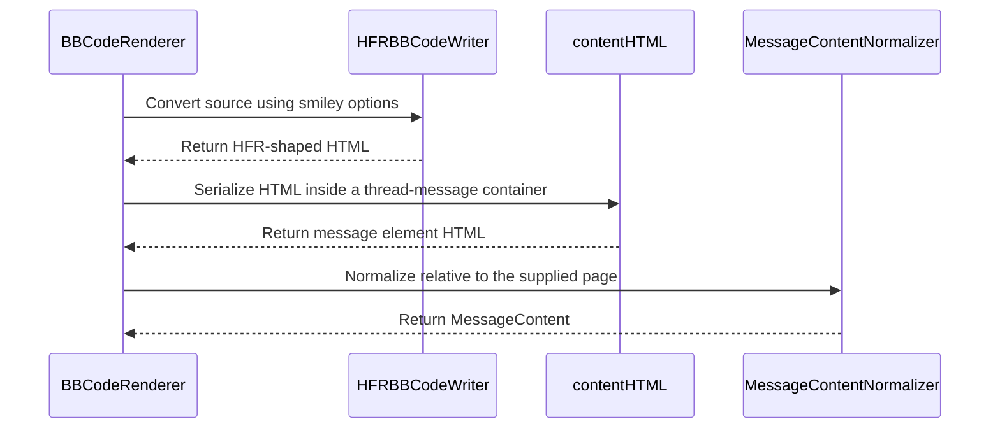

# PR #444: LOT-097: BBCodeRenderer — HFR's BBCode rendering through the LOT-034 normalizer

- State: closed (merged)
- Author: francoisgn · created 2026-11-02T17:05:35Z · updated 2026-11-11T21:13:42Z
- Labels: —
- Source: https://github.com/ezzz/HFRnow/pull/444
- Branch: ezzz:lot/097-bbcode-preview-renderer → dev-swift · head 508c12217d7502d1ac1fbfb965af3a5e6fa5eece
- Merged as 5a25d45d1c77f95d544cd4d90751271d155a70f8 on 2026-11-02T23:26:14Z

LOT-097
Closes #189
Refs #157 (FEAT-013, proposed by Bybifok; LOT-152 closes it)
Claim: cloud/lot-097

**Base:** ADR 0014 merged in #442 (`712ef29` on `dev-swift`, status Accepted, O-1 = **(b)**: this local renderer labelled as a preview, plus the on-demand `/apercu.php` preview of LOT-184, #449, M5). This branch merged `dev-swift` after it, so the diff is the code and its tests only; full `swift test` on the merged branch: 1371 tests green.

**Problem.** A poster wants to see a draft as HFR will render it (FEAT-013). The legacy app has no preview.

**What changed.** `HFRParsing/BBCode/`: `BBCodeRenderer.render(_:options:relativeTo:)` (public, pure, typed throws) and `HFRBBCodeWriter` (internal, four files). The writer follows HFR's own model (ADR 0014 §1): the source is rewritten pass by pass into the HTML string HFR writes, every pass one scan of the text **on Unicode scalars** (the code review showed that Swift's `Character`-based `replacing` lets a `"` followed by a combining mark escape the escaping), every text run escaped by one function, the fragments later passes must not touch held in placeholders; raw blocks `cpp`/`code`/`fixed`, the whitespace rule, links and images, smileys (on the text as typed, never inside a URL word), the escaping, nested `quote`/`spoiler`, `[#RRGGBB]`, inline tags as non-greedy pairs so crossed tags stay crossed, bullets. The string is then parsed **on the reader's path**: inside the thread page's markup (`td > div#para…`, the clear trailer last, the final `
` left open as HFR leaves it), serialized back as `MessageBlockParser.contentHTML` does, then `MessageContentNormalizer.normalize(contentHTML:)`; the tree builder repairs crossed tags by context, so only the same context gives the reader's repair. Nothing no captured pair proves is rendered: it stays text. No new dependency, no network, no I/O.

**Tests** (Swift Testing, 26 tests, Linux; the whole package passes):
- `BBCodeRendererOracleTests`: five differential tests, every field of `MessageContent` equal to the LOT-034 normalization of HFR's own rendering, `\r` included, after the counted reductions of the spec: `W61` → `R95d` (every toolbar tag; 1 `cpp` colour span unwrapped), `W62` → `R95h` (BMP emoji), `R41a` → `R20` message 2666649 (34 KB: `[#0055aa]`, 16 crossed `[u][b]…[/u][/b]`, 11 images, 20+ links, smileys, blank lines, trailing and leading spaces; the prefill's `textarea` entities decoded and its 11 `[url]` given back to `[img]`), `R42` → `R20` 2666682 (`:d` typed, `alt=":d" title=":D"`), `R41b` → `R20` 2666695 (personal smiley). Each asserts the pair's own counts (LESSONS 51).
- `BBCodeRendererSanitizationTests`: rejected schemes in `[url=]`, `[url]`, `[img]` (`tel:`, `mailto:` included); a line break inside brackets; raw HTML and `on*` text; quotes and a combining mark after a quote in a URL (one `href`, no member attribute); the normalizer's URL rules; a smiley-path image; 10 000 nested `[b]`, 1 000 nested `[quote]`, 10 000 unclosed tags on a cooperative-pool thread.
- `HFRBBCodeWriterTests`: every row of the rendering and whitespace tables, 21 text-fallback cases, crossed tags, smiley order, case and the URL-word and entity exclusions, trimming, `http://`, escaping, combining marks after each escaped character and after brackets, a typed placeholder, digits next to a marker, a raw block inside a URL, a bullet next to a block header, fullwidth hex digits, and ten 64 KB nesting or unclosed shapes written in well under a second (15 s allowed; the quadratic passes of round 1 took 30 s each).

**Review.** Round 1 (Opus, adversarial): REQUEST CHANGES, 10 findings (scalar-based escaping, quadratic passes, placeholder leaks and steering, raw block inside a URL, bullet eating a header break, fullwidth hex, test gaps), all fixed in `d1fa993`. Rounds 2 to 5: REQUEST CHANGES (the two-parse fidelity, every remaining superlinear pass made linear with remembered positions, a two-pass nested matcher, indexed colour closes and a smiley trie, the combining-mark injection, the flaky wall-clock bound replaced by an n-vs-4n ratio, the nested-block parse cost documented in ADR 0014 §4 and on #445), each fixed in one commit. **Round 6 APPROVE on `fd94e1b`, renewed on `cd5aa3b`** (comment-only changes since); the later heads (`c986b4d`, `2ec3881`) only merge the ADR branch's docs (O-1 = (b), LOT-184), no code change. CI on `2ec3881`: every check green but CodeQL "Analyze (swift)", cancelled with 0 steps while queued for a `macos-26` runner (repo-wide today); re-run requested. Tracker: nested-block measurements on #445, LOT-152's duties on #242.

**Merge.** Touches no state-changing flow and no `HFRModels` public type: the author merges once the ADR is merged, CI is green and the review is APPROVE, unless O-1 says otherwise.

https://claude.ai/code/session_014QH2CFTypqoZ6DJmt4ceoF

---
_Generated by [Claude Code](https://claude.ai/code)_

<!-- This is an auto-generated comment: release notes by coderabbit.ai -->

<!-- coderabbit-ai-generated:v1 -->

## Summary by CodeRabbit

- **New Features**
  - Added BBCode rendering that converts message markup into normalized content, including support for formatting, links, images, smileys, quotes, and code blocks.
  - Added options to enable or disable smileys and provide custom smiley codes.
  - Unsupported or unclosed markup is preserved as text.
- **Tests**
  - Added coverage for rendering accuracy, sanitization, formatting, and handling of complex input.

<!-- end of auto-generated comment: release notes by coderabbit.ai -->

## coderabbitai[bot] · 2026-11-02T17:05:43Z

<!-- coderabbit-ai-generated:v1 -->

<!-- This is an auto-generated comment: summarize by coderabbit.ai -->
<!-- review_stack_entry_start -->

<a href="https://app.coderabbit.ai/change-stack/ezzz/HFRnow/pull/444?scope=ghh_OusAJGA4HG8ljoOV0wJvVx8NmnZIjc2DdjmxOu0xZWA&amp;cs_source=review_comment"><picture><source media="(prefers-color-scheme: dark)" srcset="https://storage.googleapis.com/coderabbit_public_assets/review-stack-in-coderabbit-ui-dark.svg?v=3"><source media="(prefers-color-scheme: light)" srcset="https://storage.googleapis.com/coderabbit_public_assets/review-stack-in-coderabbit-ui.svg?v=3"></picture></a>

<!-- review_stack_entry_end -->
<!-- recent_review_start -->

No actionable comments were generated in the recent review.

<strong><picture></picture> Recent review info</strong>

<dl>
<dd>

<!-- review_info_content -->

<strong><picture><source media="(prefers-color-scheme: dark)" srcset="https://storage.googleapis.com/coderabbit_public_assets/review-comment-icons-v1/cog-dark.svg"></picture> Run configuration</strong>

<dl>
<dd>

- **Source mode**: Auto
- **Repository**: [ezzz/HFRnow](<https://github.com/ezzz/HFRnow>)
- **Branch**: [lot/097-bbcode-preview-renderer](<https://github.com/ezzz/HFRnow/tree/lot%2F097-bbcode-preview-renderer>)
- **File**: [.coderabbit.yaml](<https://github.com/ezzz/HFRnow/blob/508c12217d7502d1ac1fbfb965af3a5e6fa5eece/.coderabbit.yaml>)
- **Commit**: [508c122](<https://github.com/ezzz/HFRnow/commit/508c12217d7502d1ac1fbfb965af3a5e6fa5eece>)
- **Layers**: Repository YAML
- **Review profile**: ASSERTIVE
- **Plan**: Advanced
- **Run ID**: `4333edf2-4914-4e7d-81ef-4abbe8c4471a`

</dd>
</dl>

<strong><picture><source media="(prefers-color-scheme: dark)" srcset="https://storage.googleapis.com/coderabbit_public_assets/review-comment-icons-v1/git-commit-horizontal-dark.svg"></picture> Commits</strong>

<dl>
<dd>

Reviewing files that changed from the base of the PR and between 712ef29da74a8d069aa08ac09f166a81ad98c06a and 508c12217d7502d1ac1fbfb965af3a5e6fa5eece.

</dd>
</dl>

<strong><picture><source media="(prefers-color-scheme: dark)" srcset="https://storage.googleapis.com/coderabbit_public_assets/review-comment-icons-v1/file-plus-corner-dark.svg"></picture> Files selected for processing: 8</strong>

<dl>
<dd>

* `Packages/HFRKit/Sources/HFRParsing/BBCode/BBCodeRenderer.swift`
* `Packages/HFRKit/Sources/HFRParsing/BBCode/HFRBBCodeWriter+Passes.swift`
* `Packages/HFRKit/Sources/HFRParsing/BBCode/HFRBBCodeWriter+Shapes.swift`
* `Packages/HFRKit/Sources/HFRParsing/BBCode/HFRBBCodeWriter+Text.swift`
* `Packages/HFRKit/Sources/HFRParsing/BBCode/HFRBBCodeWriter.swift`
* `Packages/HFRKit/Tests/HFRParsingTests/BBCode/BBCodeRendererOracleTests.swift`
* `Packages/HFRKit/Tests/HFRParsingTests/BBCode/BBCodeRendererSanitizationTests.swift`
* `Packages/HFRKit/Tests/HFRParsingTests/BBCode/HFRBBCodeWriterTests.swift`

</dd>
</dl>

**Included review availability:** This review used your included allowance. Your plan provides up to 10 included reviews per hour; 9 remain after this review.

</dd>
</dl>

<!-- recent_review_end -->
<!-- walkthrough_start -->

<strong>Walkthrough</strong>

<dl>
<dd>

This change adds an HFR-shaped BBCode writer and a public renderer that returns normalized `MessageContent`. It supports formatting, links, images, and configurable smileys. Tests compare output with captured HFR rendering and cover sanitization, malformed markup, and repeated input.

**Changes: BBCode renderer**

|Layer / File(s)|Summary|
|:---|:---|
|**Source and text handling**   `Packages/HFRKit/Sources/HFRParsing/BBCode/HFRBBCodeWriter+Text.swift`|Adds Unicode-scalar helpers, line-break normalization, escaping, whitespace conversion, link-text trimming, and URL handling.|
|**BBCode conversion pipeline**   `Packages/HFRKit/Sources/HFRParsing/BBCode/HFRBBCodeWriter.swift`, `Packages/HFRKit/Sources/HFRParsing/BBCode/HFRBBCodeWriter+Passes.swift`, `Packages/HFRKit/Sources/HFRParsing/BBCode/HFRBBCodeWriter+Shapes.swift`, `Packages/HFRKit/Tests/HFRParsingTests/BBCode/HFRBBCodeWriterTests.swift`|Adds tag, URL, color, bullet, smiley, and raw-block conversions. The writer applies these conversions and preserves selected fragments through placeholders. Tests specify output and exercise adversarial inputs and scaling.|
|**Renderer and normalized output**   `Packages/HFRKit/Sources/HFRParsing/BBCode/BBCodeRenderer.swift`, `Packages/HFRKit/Tests/HFRParsingTests/BBCode/BBCodeRendererOracleTests.swift`, `Packages/HFRKit/Tests/HFRParsingTests/BBCode/BBCodeRendererSanitizationTests.swift`|Adds render options and a renderer that serializes generated HTML inside a thread-message container before normalization. Tests compare output with captured HFR rendering and check sanitization and options.|

<!-- change_assessment_start -->
**Estimated code review effort:** 3 (Moderate) | ~30 minutes

<!-- change_assessment_commit:"508c12217d7502d1ac1fbfb965af3a5e6fa5eece" -->
<!-- change_assessment_priority:{"version":1,"urgency":"p2","manual":false} -->
**Change:** Feature
<!-- change_assessment_end -->

### Sequence Diagram(s)

**Possibly related issues**
- ezzz/HFRnow#157 — This renderer implements the local BBCode rendering component of the preview-before-send feature.

**Possibly related PRs**
- [ezzz/HFRnow#442](https://github.com/ezzz/HFRnow/pull/442) — Defines the renderer contract and normalization path implemented here.
- [ezzz/HFRnow#23](https://github.com/ezzz/HFRnow/pull/23) — Adds the `MessageContent` normalizer used by this renderer.
- [ezzz/HFRnow#400](https://github.com/ezzz/HFRnow/pull/400) — Adds the captured source and rendering fixtures used as test oracles.

**Suggested labels:** `type: lot`

</dd>
</dl>

<!-- walkthrough_end -->

<strong>Merge Risk:</strong> <strong><picture></picture> Minimal</strong> · up to <code>508c1</code>

<dl>
<dd>

<!-- final_review_risk_start -->
<!-- final_review_risk_label
**Merge Risk:** **⚪ Minimal** · up to `508c1`
-->
<!-- final_review_risk_coverage:{"sourceCommitId":"508c12217d7502d1ac1fbfb965af3a5e6fa5eece","coveredCommitId":"508c12217d7502d1ac1fbfb965af3a5e6fa5eece","kind":"reviewed"} -->

The renderer has no identified merge-blocking defect. Non-web links are rejected before they reach rendered content.
<!-- final_review_risk_end -->

</dd>
</dl>

<strong>Security architecture risk:</strong> <strong><picture></picture> Low</strong> · up to <code>508c1</code>

<dl>
<dd>

<!-- architecture_review_start -->
<!-- architecture_review_label
### Security Architecture Review

**Security architecture risk:** **🔵 Low** · up to `508c1`
-->

The renderer preserves the existing sanitization boundary and performs no network requests or persistent changes. No introduced security vulnerability was established. Future preview integration still needs to preserve resource-loading controls and account for expensive malformed input.

**Retained concerns**
No architecture-level concerns identified.

<strong>Security review details</strong>

<dl>
<dd>

**Security Blast Radius**
- _observed_ — The new API processes caller-supplied text and options within the caller's process and returns HTML plus resource metadata. It does not itself fetch those resources, acquire credentials, or persist content; network exposure depends on a downstream consumer.

**Trust Boundaries and Controls**
- _observed_ — Untrusted text and URL attributes are escaped on Unicode scalars. Source marker characters are removed before placeholders are introduced. All public output then passes through a fresh allow-listed HTML tree; rejected link URLs are unwrapped and rejected image URLs are removed.
- _observed_ — The existing reader inserts sanitized content only into body markup, restricts remote loads through CSP, disables page JavaScript, and rechecks image policy at its scheme handler. These are existing consumer controls, not evidence that a future BBCode preview is already connected to them.

**Resilience and Maintainability Implications**
- _observed_ — Tests cover rejected schemes, raw HTML, attribute injection with combining marks, and deep malformed nesting. The nesting test explicitly provides no time bound and notes that parsing is not linear; these tests do not establish a worst-case resource guarantee. Tests were inspected, not executed in this review.

**Hardening Proposals**
- _proposed_ — When integrating preview display, preserve the reader's body-only insertion and resource-policy enforcement rather than treating normalized HTTP(S) URLs as permission to fetch. Apply caller-side input and scheduling limits appropriate to repeated draft rendering.

</dd>
</dl>

<!-- architecture_review_end -->

</dd>
</dl>

<!-- pre_merge_checks_walkthrough_start -->

<strong>Pre-merge checks: <picture></picture> 4 · <picture></picture> 1</strong>

<dl>
<dd>

<strong><picture></picture> Failed checks: 1 warning</strong>

|     Check name     |                                              Status                                              | Explanation                                                                                                                                                                                               | Resolution                                                                         |
| :---------------- | :----------------------------------------------------------------------------------------------: | :-------------------------------------------------------------------------------------------------------------------------------------------------------------------------------------------------------- | :--------------------------------------------------------------------------------- |
| Docstring Coverage |  | Docstring coverage is 68.18% which is insufficient. The required threshold is 80.00%. Docstring coverage is scoped to functions touched by this diff with cyclomatic complexity of at least 2. Documenta… | Write docstrings for the functions missing them to satisfy the coverage threshold. |

<strong><picture></picture> Passed checks: 4 passed</strong>

<dl>
<dd>

|         Check name         |                                             Status                                             | Explanation                                                                                                                                                                                               |
| :------------------------ | :--------------------------------------------------------------------------------------------: | :-------------------------------------------------------------------------------------------------------------------------------------------------------------------------------------------------------- |
|      Description Check     |  | Check skipped - CodeRabbit’s high-level summary is enabled.                                                                                                                                               |
|         Title check        |  | The title clearly identifies the main change: adding BBCodeRenderer to render HFR BBCode through the LOT-034 normalizer. It is specific and concise.                                                      |
|     Linked Issues check    |  | [`#189`] The reviewed head contains the public `BBCodeRenderer` in `HFRParsing` and the internal HFR-shaped writer. The renderer parses generated HTML through the reader path and `MessageContentNormaliz… |
| Out of Scope Changes check |  | The whole-PR changes are limited to the BBCode renderer, its internal writer, and focused renderer and writer tests. These changes implement [`#189`]. The reviewed changes add no state-changing flow, de… |

<strong>Full details: Linked Issues check</strong>

<dl>
<dd>

**Explanation**

[`#189`] The reviewed head contains the public `BBCodeRenderer` in `HFRParsing` and the internal HFR-shaped writer. The renderer parses generated HTML through the reader path and `MessageContentNormalizer`. The writer leaves unsupported, unknown, and unmatched tags as text. `docs/lots/LOT-097-bbcode-preview-renderer.md` records the ADR decision, sources, edge cases, intentional differences, and captured protocol behavior. The reported Swift Testing suite covers the five differential pairs (`W61`/`R95d`, `W62`/`R95h`, `R41a`, `R42`, and `R41b`) and the reported Linux and macOS test runs pass. The ADR is present before this code in the reviewed history.

</dd>
</dl>

<strong>Full details: Out of Scope Changes check</strong>

<dl>
<dd>

**Explanation**

The whole-PR changes are limited to the BBCode renderer, its internal writer, and focused renderer and writer tests. These changes implement [`#189`]. The reviewed changes add no state-changing flow, dependency, network operation, I/O, or public `HFRModels` type.

</dd>
</dl>

</dd>
</dl>

<strong>Full details: Docstring Coverage</strong>

<dl>
<dd>

**Explanation**

Docstring coverage is 68.18% which is insufficient. The required threshold is 80.00%. Docstring coverage is scoped to functions touched by this diff with cyclomatic complexity of at least 2. Documentation-only edits and deletions within surviving functions are included; unchanged diff context and fully deleted functions are excluded. Analyzed 44 functions across 8 files.

**Resolution**

Write docstrings for the functions missing them to satisfy the coverage threshold.

</dd>
</dl>

</dd>
</dl>

<!-- pre_merge_checks_walkthrough_end -->
<!-- finishing_touch_checkbox_start -->

<strong>Finishing Touches</strong>

<dl>
<dd>

<strong>Generate docstrings</strong>

<dl>
<dd>

- [ ] <!-- {"checkboxId":"3e1879ae-f29b-4d0d-8e06-d12b7ba33d98"} --> Commit to this branch
- [ ] <!-- {"checkboxId":"7962f53c-55bc-4827-bfbf-6a18da830691"} --> Create a new PR

</dd>
</dl>

<strong>Generate unit tests (beta)</strong>

<dl>
<dd>

- [ ] <!-- {"checkboxId": "6ba7b810-9dad-11d1-80b4-00c04fd430c8", "radioGroupId": "utg-output-choice-group-unknown_comment_id"} --> Commit to this branch
- [ ] <!-- {"checkboxId": "f47ac10b-58cc-4372-a567-0e02b2c3d479", "radioGroupId": "utg-output-choice-group-unknown_comment_id"} --> Create a new PR

</dd>
</dl>

</dd>
</dl>

<!-- finishing_touch_checkbox_end -->

<!-- autopilot:start -->
- [ ] <!-- {"checkboxId":"2708ad07-9f24-4260-9c11-7dc76a49f2e3"} --> <strong title="Keep fixing CodeRabbit findings and required CI, and resolving merge conflicts">Autofix</strong> · Keep fixing CodeRabbit findings and required CI, and resolving merge conflicts
<!-- autopilot:end -->

## francoisgn · 2026-11-02T22:38:34Z

**State for cloud/orch** (the author stops here, as instructed: no further CodeQL re-run).

- Head: `508c12217d7502d1ac1fbfb965af3a5e6fa5eece` = `cd5aa3b` (code, Opus round 6 APPROVE renewed on it) + the merged ADR docs + `dev-swift` at `712ef29` (#442 merged). `git diff cd5aa3b 508c122 -- Packages/…/BBCode` is empty: no code change since the APPROVE. Full `swift test` on this head: 1371 tests green.
- CI on `508c122`: every check green **except CodeQL "Analyze (swift)"**, cancelled with 0 steps on both attempts (no `macos-26` runner picked it up; attempt 2 queued 22:16–22:31 UTC). Not a code failure: the same job was skipped-or-green on every docs head and the macOS/iOS build and test job of this PR is green.
- Left to do by whoever re-runs it: re-run the failed job of run 41532629755 (or push nothing and re-run from the Actions tab) until a runner serves it; once green, mark ready and squash-merge; then close #189 with `Done in #444 (merged as <sha>)` (`Closes #189`, closing keywords do not fire on `dev-swift`). Touches no state-changing flow and no `HFRModels` public type.
- `Claim: cloud/lot-097`.

---
_Generated by [Claude Code](https://claude.ai/code)_
